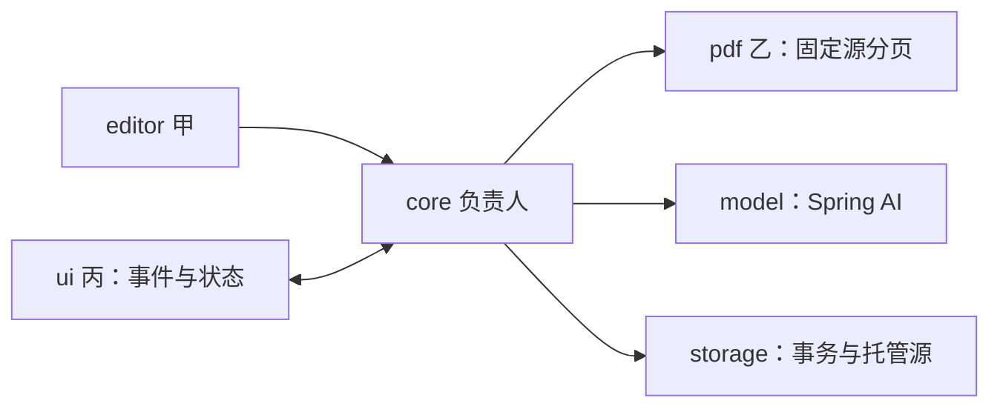

# F0 Java 工程与提交契约蓝图

更新：2026-10-16（Asia/Shanghai）。状态：讨论提案，未创建主插件工程、可编译接口包或正式候选。权威状态为 `WORKING.json`。本文件承接 `PARALLEL_START.md` 与 `P0_READINESS.md`，供四份任务对齐实现边界。

## 1. 最小工程与修改归属（提案）

先评估一个插件构建、一个安装包，按 Java 包划分职责；暂不拆多个 Gradle 子工程。以下 `<base>` 是未定的包名前缀，不是已建立的目录。

```text
src/main/java/<base>/
  contract/    不可变输入、输出、事件和端口；负责人协调
  core/        session、草稿、请求、入库、检索、引用与压缩编排；负责人
  editor/      IDEA 动作和 Java PSI 捕获适配；甲
  pdf/         固定 PDF 的物理分页读取；乙
  ui/          Tool Window、标签、渲染和视图订阅；丙
  model/       Spring AI 生成/嵌入适配与客户端资源；负责人
  storage/     事务、查询、条件写入及托管文件；负责人
  bootstrap/   服务装配与资源所有权；负责人
src/main/resources/META-INF/plugin.xml
```

`contract` 不依赖 Swing、IDE PSI、具体数据库或模型 SDK；原始文本、稳定身份与状态跨边界传递。`core` 不直接操作编辑器或 Swing 组件。`bootstrap` 装配真实适配器与模拟适配器；不要求引入 Spring 容器、依赖注入框架或本地 HTTP 服务。Spring AI 仍是必须保留的模型框架，具体手动装配路线继续按 P0 验证。



图中箭头是调用/数据方向，不表示额外进程；各包都在同一插件评估路线中。公共构建、契约、注册文件由负责人维护，各成员可提出修改，由负责人统一接入。

## 2. 最小 Java 端口（提案）

下列是签名示意，类型细节和导入省略，尚不是可编译源码。沿用现有 `SelectionSink`、`PdfReader` 和 `SessionController` 名称；不为每个业务对象新增一套通用框架。

```java
interface SelectionSink {
    CaptureTicket beginCapture(SelectionStart start);
}

interface CodeCapturePort {
    CompletionStage<CapturedCodeGroup> capture(SelectionStart start);
}

interface PdfReader {
    PdfReadResult read(PdfReadRequest request) throws IOException;
}

interface SessionController {
    CompletionStage<ViewEventResult> dispatch(ViewEvent event);
    ViewSubscription observe(ProjectInstanceId project, ViewStateListener listener);
}
```

| 输入/输出 | 最小字段与约束 |
| --- | --- |
| SelectionStart | captureId、源 projectInstanceId、fileRef、documentVersion、原选区文本/范围；正文与版本在动作开始固定 |
| CaptureTicket | captureId、projectInstanceId、targetSessionId、draftId；由核心分配或校验，适配器不能改目标 |
| CapturedCodeGroup | 相同 captureId/文件版本的原选区、方法全文、类结构，以及各项 captured / not-applicable 等明确结果；异常不包装成成功空组 |
| PdfReadRequest | documentId、sourceVersionId、managedSnapshotRef、contentHash；乙只消费固定源 |
| PdfReadResult | 同一来源身份、physicalPageCount、按物理页连续编号的 pages；无文字页也有记录 |
| ViewEvent | eventId、projectInstanceId、明确动作和目标身份；发送/移除带 draftId 与 expectedDraftRevision，停止带 operationId |
| ViewEventResult | applied / rejected 及原因和最新状态版本；异常保留原原因交任务边界，不伪造普通拒绝 |
| ProjectChatViewState / SessionViewState | 不可变视图快照、状态版本、草稿保存/捕获状态、任务/生命周期、可执行动作、回答依据；不暴露可变业务集合 |

`CodeCapturePort` 由甲实现、核心调用。`beginCapture` 返回后由核心安排捕获与持久化，并观察完成/异常；完成合并是核心内部步骤，不由 UI 根据当前标签再次提交。捕获 API 返回异步阶段不代表取消已经传到平台任务，底层取消句柄及释放仍需实现验证。

`observe` 的订阅只管理视图观察；关闭订阅不取消 session 任务。回调不隐含 EDT 线程保证，UI 适配器切回正确线程后更新组件。旧视图或旧状态版本不能覆盖新视图，关闭后的组件不接收更新。

## 3. 捕获组与草稿命令

用户已确认代码快照只读，可整组移除并重新捕获，依据 `evidence/user-turn-025.md`。组内原选区、方法与类结构分别渲染，不能通过编辑代码卡片改写固定正文。

| 步骤 | 核心规则（算法为提案） |
| --- | --- |
| 开始 | 在动作开始的快速内存路径绑定源项目的当前 session；没有可用当前标签时预分配新 session 身份。此步不做 DB/PDF/网络或耗时 PSI 工作 |
| 预留 | 为 ticket 建立待捕获组，后台先保存必要的新 session/draft/组初始化，成功后才调用 CodeCapturePort；保存前不显示已保存，也不允许依赖它发送 |
| 捕获 | 甲在平台允许的读操作中校验同一文档版本并捕获；转成不可变文本，正常缺失与异常分开 |
| 合并 | 核心只补齐 ticket 指向且仍存在的待捕获组，保留期间新增的文字/其他组；不能要求草稿 revision 仍等于开始值 |
| 移除 | `RemoveDraftCapture(eventId, projectInstanceId, sessionId, draftId, expectedDraftRevision, captureId)` 一次移除全组并使 ticket 失效；未完成组移除后不再阻塞其余就绪材料 |
| 再捕获 | 新动作使用新 captureId 与新固定快照；不覆盖旧组或已提交历史。用户回到编辑器重新选取时仍按当前项目/当前标签规则定位 |

移除、提交和普通草稿修改按 session 的短命令顺序协调；并非整个模型调用占有这条命令执行路径。移除使用当前草稿版本校验；版本过期则拒绝并保留输入供刷新，不猜测删除。已提交内容不再属于待发送区，不能用移除草稿命令改写历史。

捕获完成不替换整份草稿。文字更新同样只更新文字部分，不能带旧代码列表覆盖刚到达的捕获组；视图刷新也不能覆盖尚未确认保存的本地文字。UI 需保留未确认编辑，提供保存状态，核心校验版本后再消费。具体保存频率仍由实现测量，不填随意的定时参数。

首次创建的预留票据也能被移除/删除或项目关闭撤销。初始化与这些控制动作进入同一 session 命令顺序，首次 INSERT 前仍检查预留票据有效性；只有合法新建登记可创建根记录，完成回调不能自动创建。若删除先发生且数据库尚无根记录，撤销创建票据并清理本地预留即可，迟到初始化不得重新 INSERT。这不需要另建通用票据框架。

若移除与完成竞争，只有仍存在的组可被补齐；即使先完成后移除，最终也应整组消失。若提交先成功，之后的旧移除命令因草稿版本不符被拒绝，历史快照保持不变。忙时仍可编辑/移除新草稿；在途回答使用提交时固定材料。

重启后未完成的捕获组不能伪装就绪，也不自动回读已变化的源文件；提案为显示需要重新捕获，允许整组移除。正常捕获异常仍遵守开发暴露、实际使用提示的规则。

## 4. 本地持久化的最小关系（提案）

下表是逻辑表组，不是已定 DDL。业务数据库 H2 已由用户确认，优先以统一事务存储保存 session 文本/快照/视图布局，避免为每条消息另建旁存文件；托管 PDF 作为共享大文件旁存。版本、具体结构及 IDE 集成尚未验证。

向量检索已由用户指定为 JVector，耐久存储采用 H2。图是应用级固定代次的派生结构，CourseRetriever 对接查询与证据映射；原始向量编码和内存图恢复为优先提案，详见 `JVECTOR_RETRIEVAL.md`。不再采用自制精确全扫描作为默认检索实现。

| 表组 | 关键身份/关系 | 必要约束 |
| --- | --- | --- |
| Project / Session / ProjectTab | 稳定 projectId、sessionId、session 生命周期、标签顺序/活动引用 | projectInstanceId 只用于本次打开；移动保留会话，复制不继承已确认；路径/标题或可复制 UUID 单独不足以决定归属，绑定校验先于恢复，见 PERSISTENCE.md 第 5.1 节 |
| Draft / CaptureGroup / CodeSnapshot | sessionId、draftId/revision、captureId、partId、snapshotId | 快照与组有明确 session 所属；组有就绪/不适用/失败等状态，正文不可变 |
| Message / MessagePart / Turn / Attempt | sessionId、有序序号、原始 message、关联尝试及结果 | 同 session 内命令去重、顺序唯一；重试追加尝试，不复制用户问题或改写摘要前缀 |
| AnswerEvidence / Checkpoint / UsageDiagnostic | sessionId 与所属 attempt/checkpoint、来源范围 | 私有证据/摘要/用量等均能按 session 定位和删除；checkpoint 不能替代原档案 |
| CourseDocument / SourceVersion / Page / Chunk / IndexGeneration | 共享 documentId/sourceVersionId、物理页、嵌入空间及代次 | 不引用 session 作为所有者；旧回答绑定固定来源；删除 session 不级联删除课程库 |

外键/复合约束须覆盖 session 所属关系，不能只检查 snapshotId 存在。唯一约束补充 commandId / captureId 去重；外键不能替代操作有效性和生命周期条件校验。课程引用的真实来源身份/物理页与显示标签分别保存。

仓储读写带 projectId + sessionId 校验归属，应用级存储不意味着项目可按裸 sessionId 任意读取。历史 AnswerEvidence 保存必要引用定位和证据内容，绑定需要保留的 sourceVersionId；不能强依赖允许清理的旧 chunk 行才能打开旧回答。ProviderProfile 与平台凭据保存继续分开。

应用服务拥有连接与短写入路径；可先评估一个后台串行写入入口，避免四处直接连接数据库。该路径不执行远程调用、PDF 解析或长扫描，不新增消息中间件。具体连接/事务并发、批次和性能需验证。

## 5. 必须原子成立的提交（提案）

| 提交 | 同一短事务或条件提交中的内容 |
| --- | --- |
| 发送草稿 | session 可用、无活跃生成/整理、草稿版本与捕获组就绪检查；commandId 去重、user message/parts/快照引用、turn/attempt、活跃操作身份及本次草稿消费 |
| 捕获完成/整组移除 | session/draft/组仍有效；仅合并目标组或整组移除，更新草稿版本；后者同时撤销回写资格 |
| 回答/终止 | 原 session、project 打开实例和 operation 仍有效；正文/实际证据/完成或未完成状态与一次终止结果共同成立 |
| checkpoint 激活 | 原 session/操作有效、基准 checkpoint 与前缀匹配；完整候选与活动指针条件更新 |
| 删除会话 | 首先持久化删除中栅栏并撤销写入资格；清理全部私有记录/缓存/布局及可能的私有文件，完成后硬删剩余根记录并反馈成功 |

所有 session 所属业务状态写入都通过同一 session 提交规则，不能“先查存在、释放事务、稍后 upsert”。若采用数据库行锁/条件更新，其校验与写入必须在同一短事务内。普通写入要求 session 可用；清理命令允许在 DELETING 下完成清理，共享课程写入另走应用级规则。内存失效与底层取消先阻止新工作，但不替代落盘条件；更早已进入提交的写入也须与删除建立确定顺序，先完成的内容由删除覆盖清理。

删除中的根状态仅用于拒绝迟到写入和完成清理，不能用于恢复可聊天档案。失败时如实显示删除未完成；重启后识别未完成删除，不恢复为正常 session，提供继续清理入口。成功后不保留 session 内容、删除日志副本或可恢复软档案。若另有私有旁存文件，需先有可恢复的清理身份再处理跨介质步骤；不能先丢掉文件定位后宣告成功。只实现这些必要边界，不引入通用修复、outbox 或事件溯源系统。

模型/摘要/嵌入等远程等待期间不持事务；会话忙碌标记不会锁住草稿编辑。存储提交失败不调用模型并假称材料已保存，开发暴露原错，实际使用提示并暂停依赖该提交的操作。

发送入口先校验项目归属、当前打开实例及 session 可用，再识别已提交的同一 commandId/草稿版本；重复交付只返回原提交身份，不再次调度请求。只有新提交再检查忙碌槽、精确草稿 revision 和完整捕获组。版本发生变化就拒绝旧提交，不实现旧草稿自动合并：新编辑先保存则旧发送过期；发送先提交则后续编辑留在后继草稿。事务成功后才开始检索/模型调用，不能在提交前先产生外部调用副作用。

## 6. 平台线程与资源所有权（提案）

| 所有者 | 工作与资源 | 终止边界 |
| --- | --- | --- |
| 应用服务 | 同一 IDEA 进程共享课程库、存储连接、应用资源与导入任务 | 插件卸载/IDE 退出使任务失效并请求取消、释放资源；关闭单个项目不销毁共享库 |
| 项目服务 | session 协调、活跃 operation、模型/捕获取消句柄与项目提示 | 项目关闭使旧 projectInstanceId 失效并取消其任务；插件卸载同样清理，重开不接收旧回包 |
| 标签视图 | Swing 组件和状态订阅 | 关闭只释放视图资源，session 任务继续；删除走独立业务命令 |

EDT 仅处理轻量动作、快速身份绑定和渲染；数据库、PDF、网络和耗时 PSI 工作在后台。PSI/VFS 访问使用平台读操作，尽快转成固定数据，不跨网络等待保留 PSI 对象或读锁。Java 读操作路径仍需在目标 SDK 验证；官方同时更推荐新插件使用 coroutine API，本项目的纯 Java 约束继续保留。依据 [线程模型](https://plugins.jetbrains.com/docs/intellij/threading-model.html)。

Tool Window 标签可用 ContentManager 管理，视图资源挂到对应 Content 的 Disposable；相关 UI 调度遵守 ToolWindowManager 的要求。服务资源挂在所属插件服务的生命周期下，不能直接把 Project/Application 作为插件资源的父 Disposable。依据 [Tool Windows](https://plugins.jetbrains.com/docs/intellij/tool-windows.html)、[Disposer](https://plugins.jetbrains.com/docs/intellij/disposers.html)。

实现 Disposable 不会自动取消所有 Java/HTTP 工作；取消标记需要任务配合，实际取消能力要验证。平台 `ProcessCanceledException` 是取消控制流，不能吞掉、记作故障或触发通识降级；读操作因平台写入而重启时也不应因此污染业务故障状态。即使底层没及时停止，提交栅栏仍拒绝迟到结果。依据 [后台任务与取消](https://plugins.jetbrains.com/docs/intellij/background-processes.html#cancellation)。

关闭项目的本地收尾由生命周期协调方委托应用级存储完成，不依赖已失效的模型回调：按原 projectInstanceId + operationId 条件，将仍未终止的操作标为中断/取消并释放其活跃槽，不改写已成功终止或删除中的记录。此清理写入有独立的生命周期权限，不能被“原项目实例必须仍打开”的回包条件挡住。每次重开项目先协调旧实例遗留操作，再开放新发送；晚到的旧收尾不能清掉新实例的活跃槽。若 IDE 退出前未完成提交，则按已保存状态在下次打开时处理，不伪造已落盘。

采用 H2 时不用中断数据库 I/O 线程实现业务取消；HTTP、平台读任务与数据库短提交分别处理。退出时区分已提交和待保存状态，不能把内存中已更新视为磁盘已恢复承诺。

## 7. 四人接入的最小顺序与证据

1. 负责人给公共签名/不可变样例、插件骨架、装配入口及统一验证命令；P0 的 IDE 加载/依赖运行仍需实际执行。
2. 甲接 beginCapture 与 CodeCapturePort；乙接 PdfReader；丙接 SessionController 的事件/状态。三者先消费模拟核心，负责人同步推进真实数据链。
3. 模拟联调先检查固定目标、只读代码整组移除、迟到捕获不复活、草稿新文字不被覆盖、空白页编号、关闭标签继续与忙时保留草稿。
4. 再替换真实 PDF、模型、存储与检索，验证完整提交、重启恢复、删除全清及实际使用故障分支；必要业务场景与平台运行验证各自留证据。

本轮只完成契约蓝图和合成场景，不声称 Java 签名已编译、事务已运行或 P0 通过。摘要模型、Token 预算和失败参数仍由对应实施成员确认；不在这里填值。

## 8. Markdown 与 IDEA 多色高亮

用户已明确 UI 渲染以 Markdown 为主，代码块采用 IDEA 多色高亮，依据 `evidence/user-turn-026.md`。以下字段与组件仍为提案，尚未在目标 IDEA 中验证。

### 8.1 原文与显示分开

继续保存 Message(role, parts)：TextPart.text 保存原始 Markdown，可加 format=markdown；code-selection / code-context 继续引用固定 CodeSnapshot。解析树、HTML、颜色和缓存只用于派生显示，不写回原文或 LLM 输入。Markdown 标题或语言标记不改变 role。

对话正文以 Markdown 显示，草稿文字保持可编辑的源文本；草稿代码仍只读、整组移除。typed 代码不先拼成 Markdown 再解析，代码自身的反引号不得改变消息结构。

建议统一 CodeRenderInput(blockKey, codeText, languageHint, origin, sourceRevision)：Markdown 围栏/缩进代码和选区/方法/类结构共用 IDEA 高亮适配器。blockKey 只是派生显示身份，不新增原始 message part；origin 保留 message/part/snapshot 关联。

### 8.2 优先评估的轻量路线

优先评估 Java Markdown 解析器生成完整 AST，自定义代码节点渲染，放入单一 Swing HTML 消息组件。段落、标题、强调、列表、引用、链接、行内代码、代码围栏及表格为首版显示范围提案，方言/扩展和版本未锁定。保留嵌套结构，不按反引号字符串切割消息。解析器可评估 [commonmark-java](https://github.com/commonmark/commonmark-java) 的 AST/HTML 与表格扩展，尚未加入项目依赖。

代码颜色来自 IDEA 语言高亮器与当前编辑器配色，区分关键字、字符串、数字、注释等；配色变更后重建显示缓存。Java 为首个验证语言，其他语言使用目标 IDE 已有能力；未标语言/未知语言明确按普通代码显示，不猜成 Java。行内代码仅用等宽样式。

官方说明 TextAttributesKey 与 EditorColorsScheme 映射，并提供高亮 HTML 示例路径，见 [语法与错误高亮](https://plugins.jetbrains.com/docs/intellij/syntax-highlighting-and-error-highlighting.html)。原生只读 EditorTextField / Editor viewer 是比较路线，见 [Editor Components](https://plugins.jetbrains.com/docs/intellij/editor-components.html)。当前优先减少历史代码块持有的编辑器实例，尚无性能结果证明最终选择。

具体 API 需验证：[本机版本对应 HtmlSyntaxInfoUtil 源码](https://github.com/JetBrains/intellij-community/blob/idea/262.10968.63/platform/lang-impl/src/com/intellij/openapi/editor/richcopy/HtmlSyntaxInfoUtil.java)有需要 read lock 的入口、实验性 builder 与弃用方法；部分片段入口会创建 PSI、做 QuickDoc 预处理或规范化缩进/制表符。不能当作无需锁的纯字符串工具，处理结果不覆盖原始代码。优先验证受支持入口或直接用语言高亮 token/配色生成转义片段，原目标 262.9437.185 另行核查。

本需求落实为 IDEA 配色的多色语法高亮；全项目符号解析、错误检查和变量语义着色不默认追加为 F0 功能。具体实现即便能提供额外颜色，也不等于完成项目语义验证。

### 8.3 显示边界与验证

HTML 只由受控渲染器生成，原生 HTML 转义显示，代码按原文转义；语言标记仅映射高亮器。MVP 不引入执行脚本、运行代码或自动加载远程图片的扩展。课程引用仍绑定核心提供的证据身份，任意 Markdown 链接不能伪造来源。

解析/高亮遵守后台与平台 read action 规则，组件更新在 EDT；缓存按内容版本、语言和配色版本区分，旧回调不更新已关闭标签。关闭/删除清理显示缓存和监听，后台任务归属不变。第一版已确认流式显示：未闭合围栏保留可读代码，按消息版本更新，不改原文或每个 token 重建整段历史；前缀版本、epoch 与终止收敛规则见 `STREAMING_RESPONSE.md`。

开发渲染故障暴露原错；实际使用提示受影响，并可用转义原文维持阅读。未知语言是正常状态，与异常分开；不能无提示把已要求的 Java 高亮长期按普通文本交付。

最低验证包括：Markdown 嵌套列表/表格/代码块，Java 多色和浅/深色配色切换，围栏与 typed 代码共用高亮，原始正文/缩进及复制源保持不变，未知语言，长历史滚动/内存，关闭重开后的释放，以及未闭合围栏/增量更新。当前已执行本机 SDK 静态检查、独立 Swing 合成颜色离屏探针和本地五个 Markdown 前缀解析；IDE 高亮/配色/流式/资源运行未验证。证据见 `STREAMING_RESPONSE.md` 第 5 节。丙负责呈现，负责人协调依赖/公共契约及平台验证，仍按 5:1:1:1，新增成本需实测。

## 9. 流式回答接入

第一版回答流式显示已由用户确认。最小模型事件、累计正文、部分保存、结束证据、断流/重试及增量渲染契约见 `STREAMING_RESPONSE.md`。核心为每个 ModelStep 持有唯一订阅，UI/存储只消费核心状态；关闭标签不取消模型，删除仍清全部记录。流式能力与课程网关契约须单独验证，不能以本地 Markdown 探针宣称真实端到端流已通过。

## 10. 已采纳 ReAct 的接入点

`REACT_ORCHESTRATION.md` 是当前 F0 编排契约。core 管理同 attempt 内 branch/step、工具分派、有限循环、证据与终止；model 将完整结构化输出交核心，不能在另一层再启动隐藏循环。每步骤唯一订阅替代此前“同 attempt 只有一次模型请求”的提案。

新增逻辑记录为 ModelStep / ToolInvocation / ToolObservation / ProtocolState，均由 session 根约束归属、写入权与删除；协议状态不混进普通 Markdown 消息。UI 渲染过程状态和当前步骤预览，工具返回不自动成为最终回答。具体 Java 接口、库版本和真实网关能力仍待 P0 验证，不由图自动选用 MCP 或框架自动工具执行。

## 11. 开停、课程资料视图与上下文资格

`F0_BEHAVIOR.md` 和 `COURSE_LIBRARY.md` 承接 user-turn-032。API key 修改先停用；应用级工作状态和配置 epoch 约束全部网络入口，停用协调方保存终止快照但旧网络回包无写入权。工具/思考渲染到独立可折叠小字区，停止/重试/超限/中断保留已经显示内容。

原始档案不等于模型记忆：后续上下文和摘要先按耐久成功 attempt/有效 branch 过滤；中断生成输出不得经 checkpoint、缓存或协议字段重新带回。原问题/代码保持，重试不重复用户消息。user-turn-033 更正为在资料视图选中目标后更换/移除；MD5 去重复用既有 CourseDocument/SourceVersion 并增加 ManagedBlob 与课程代次绑定，版本原子发布及旧证据保留由核心实现，表结构与目录仍待验证。

## 12. 应用命令与停用完成

应用级 ApplicationController / ApplicationViewState 与项目级 SessionController 分开，具体字段见 PARALLEL_START.md 第 8 节。开停、配置和共享资料动作不要求当前 session；资料动作固定 documentId/预期版本/修订及库基准。纯 Java 接口仍是未编译提案，不宣称已交付。

工作状态为 OFF/STARTING/ON/STOPPING。停用完成依据本地旧操作权撤销、任务终止/活跃槽协调和保存结果处理，不无限等待远端物理取消。未保存结果如实提示并保留受影响会话的阻塞；再次启用不绕过该阻塞，也不续跑旧任务。对应恢复顺序仍见 F0_BEHAVIOR.md 第 6 节及既有项目生命周期规则。
