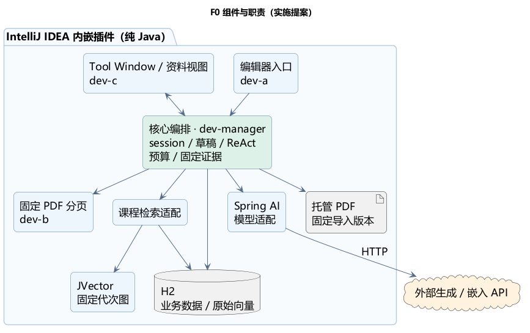
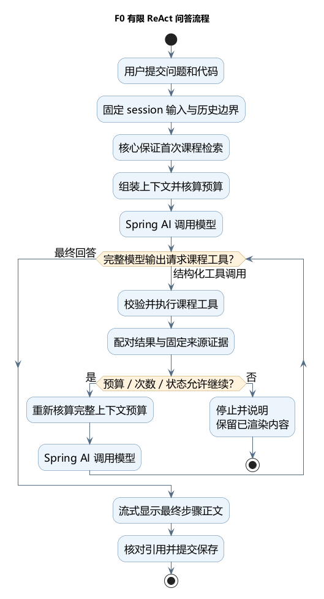

# F0 插件综合开发方案

日期：2026-10-18（Asia/Shanghai）。初稿依据内部讨论 revision 27 / contentRevision 28及作业F0要求；初始化时按用户最新更正更新IDE验证范围。原始资料/答复仅留负责人本地。本文件是开发方案，不是正式冻结架构、已运行产品或兼容性承诺。

文中“已确认”来自用户或作业；“实现提案”供开发采用与验证；“待定”继续保留原状态。详细设计文件保留，本文作为统一阅读入口。

## 目录

- [1. 目标与范围](#goals)
- [2. 总体架构与职责](#architecture)
- [3. 课程资料管理与检索](#corpus)
- [4. ReAct 问答流程](#react)
- [5. Session、代码与渲染](#sessions)
- [6. 中断记录和上下文压缩](#context)
- [7. 开停、配置与项目迁移](#activation)
- [8. 存储与提交规则](#persistence)
- [9. 异常与降级](#failure)
- [10. 四人分工及实施顺序](#delivery)
- [11. 验证与未决项](#verification)

## 1. 目标与范围

提供 IDEA 内嵌的 Java 课程助教：课程 RAG、模型基础知识、来源引用，以及用户选中代码的上下文问答。首版只有这两类知识来源，不增加其他工具能力。

| 约束 | 已确认内容 |
| --- | --- |
| 技术 | 保留 Spring AI；业务源码纯 Java；H2 业务存储；JVector 向量检索 |
| 安装与平台 | 用户只安装插件，优先内嵌；Windows，始终只验证本机当前IDEA版本；目前为2026.2.3 / 262.10968.63 |
| 模型服务 | DeepSeek 与课程平台；允许远程生成、远程嵌入，优先减少包体；准确接口/模型待核验 |
| 资料 | 用户导入可复制文字 PDF，首版预计几十份、约 1000 页；这不是已测硬上限 |
| 共享边界 | 同一 IDEA 进程内共享课程库；项目/session 隔离聊天和代码 |
| 会话 | 同项目多 session，Tool Window 标签切换；聊天/快照/草稿/标签布局重启恢复 |
| 团队 | 相对工时 5:1:1:1，四人使用同一套 AI coding 体系；无已确认绝对工时 |
| 原则 | MVP；开发暴露原错，实际使用明确提示并按定义降级 |

内嵌是优先路线，尚未完成IDEA中的业务运行验证。用户已更正为始终只验证本机实际版本：当前262.10968.63，构建/CI固定同版本；本机升级时同步，不再单独验证旧目标。

## 2. 总体架构与职责

**实现提案：一个插件构建、一个安装包，按 Java 包分工。** 不因 Spring AI 引入额外 Boot 服务、独立 Agent 进程或 MCP。

图 D01 · 总体架构与职责。可编辑图源：[PlantUML](diagrams/f0-components.puml)。

应用级服务拥有共享课程库、H2、索引代次和业务开停；项目级服务协调本项目 session。标签只拥有视图和订阅，关闭标签不取消任务。EDT 只做轻量交互，数据库/网络/PDF 在后台，PSI 读取后立即转换为不可变快照，不持锁等待网络。

公共端口已落为 `edu.courseassist.contract` 下的可编译 Java 接口：SelectionSink、CodeCapturePort、PdfReader、SessionController，以及处理应用级开停/配置/共享资料的 ApplicationController 和短期凭据交付入口 CredentialUpdateSink；应用命令不要求 sessionId。DTO、具体签名与合成夹具以 [API.md](../contracts/API.md) 和当前源码为准；接口与夹具存在不代表业务实现已完成。

## 3. 课程资料管理与检索

**已确认：课程资料视图中点击选中具体资料，再更换或移除；重复导入按 MD5 排除。** 原 chapter 替换规则已被更正，不要求章节分类。

实现提案：

1. 资料视图列出名称、当前版本/导入时间、状态及可得页数。动作开始绑定稳定 documentId、预期源版本和修订号；之后切换选中项不改变任务目标。
2. 将所选 PDF 复制成托管快照，对固定副本计算 MD5。重复导入定位已有资料，不产生重复原件；处理中/失败/已移除与就绪状态分开。
3. 更换保留 documentId，创建或复用该资料的 SourceVersion；相同字节可复用 blob，来源身份独立。派生结果还须匹配处理配置和嵌入空间，不能只凭 MD5 复用向量。
4. 按物理页提取并在页内分块，空白页保留编号；记录 documentId/sourceVersionId/chunkId、物理页及范围。更换、分块和嵌入先准备候选，成功后共同发布资料版本和索引代次。
5. 发布校验资料修订、任务有效性和全库代次基准；失败、取消或基准变化不覆盖旧就绪版。不同资料并发更新也不能互相覆盖。
6. 移除使该资料退出后续检索活动集合，历史/在途引用保留固定版本。该保留细则为提案；原件彻底清理另走显式入口，只清理非活动、无全库引用/在途占用的旧版本，不静默按容量淘汰。

H2 保存原始向量、片段、配置和映射；JVector 优先从耐久向量后台恢复不可变内存图，不重新请求文档嵌入。GenerationHandle 同寿命持有图、原始向量和 ordinal→chunk 映射，每查询独立 searcher。attempt 建立时固定库代次（含无库状态），首次检索和全部课程工具均沿用；新 attempt 才读取最新活动集合，不能中途追随资料替换。

已有库的图正在恢复时显示“课程索引恢复中”，不能冒充未建库或无命中。JVector 是 ANN；具体版本、分块参数、Top-K/阈值与性能由真实样本验证，不把命令行小探针当作实际召回证明。

详细规则：[COURSE_LIBRARY.md](COURSE_LIBRARY.md)、[JVECTOR_RETRIEVAL.md](JVECTOR_RETRIEVAL.md)。

## 4. ReAct 问答流程

用户已采纳如下主流程；工具名称、限额和框架装配仍是实现提案。

图 D02 · 有限 ReAct 问答流程。可编辑图源：[PlantUML](diagrams/f0-react.puml)。

首轮课程检索由核心保证，之后可用 searchCourse(query)、readCourseEvidence(ref) 补查；模型基础知识由模型直接提供，不单独伪造“知识工具”。工具以完整结构化请求为准，参数流尚未聚合完整不能执行。

一次用户提交仍是一个 turn/attempt 和一个 session 活跃任务。attempt 内可串行包含多个 ModelStep，每步唯一模型订阅，整个循环只有一个所有者；不能同时让框架和外层代码重复驱动工具。branchId、stepId、toolCallId 和持续单调 seq 固定结果归属。

每步重新核算规则、工具定义、历史、代码、证据、工具轨迹及必要协议字段。有限循环、工具次数/结果大小/耗时需有配置，数值由实施测量后回填。tool_calls 只结束当前模型步骤；最终有效步骤正常结束且正文/证据/状态共同保存后，才显示完成。

引用仅认可实际传入最终步骤的有效证据；前序工具取得并传入最终步骤的来源可引用。最终回答明确显示“资料名称＋PDF 物理页码／范围”，点击按固定托管版本定位；不按最新 PDF 改写旧回答。

详细规则：[REACT_ORCHESTRATION.md](REACT_ORCHESTRATION.md)、[STREAMING_RESPONSE.md](STREAMING_RESPONSE.md)。

## 5. Session、代码与渲染

- 右键选区进入编辑器所属项目的当前 session 标签；没有当前会话则新建。目标在动作开始绑定，异步捕获不重新读取当前标签。
- 同次捕获保留原选区、所在方法全文、类声明/字段结构，来自同一文件版本，作为独立类型先进入待发送区。快照只读，可整组移除和重新捕获；再次选取相同文字仍是新片段。
- 捕获未就绪或失败时不发送半套上下文。正常无所在方法与捕获错误分别表示；跨边界/非 Java 等实施规则在 P0 验证，不扩为整项目读取。
- 发送冻结确切草稿版本，消息/快照引用、去重记录和草稿消费共同提交；失败保留草稿。忙时仍可编辑草稿，但不排队、不自动发送；其他 session 独立。
- 普通文字主要渲染 Markdown，代码用 IDEA 多色高亮并跟随配色。typed 代码直接显示固定正文，不先拼成 Markdown；HTML/颜色是派生显示，不进入档案正文或模型输入。
- 工具过程和服务实际提供的思考信息采用独立可折叠小字区；没有思考信息时只显示真实步骤状态，不编造内容。生成正文逐步显示，工具步骤预览不拼成最终答案。
- 停止、重试、超限和中断保留已生成/渲染内容。重试新增尝试块，不覆盖旧块；旧回包不能追加到已冻结结果。
- 普通关闭标签保留记录且任务继续；列表重开不重新请求模型。删除 session 才移除全部该 session 档案、草稿、工具/协议/摘要/诊断/缓存及布局引用。

详细规则：[PARALLEL_START.md](PARALLEL_START.md)、[ENGINEERING_BLUEPRINT.md](ENGINEERING_BLUEPRINT.md)。

## 6. 中断记录和上下文压缩

**显示档案不等于模型记忆。** 后续提问、检索查询、摘要与协议缓存共用输入资格规则。

| 内容 | 界面/档案 | 后续模型输入 |
| --- | --- | --- |
| 已提交原问题和代码 | 保留 | 按历史规则使用，重试不重复原问题 |
| 最终有效分支的耐久成功回答及合法工具协议 | 保留 | 可按预算和压缩规则使用 |
| 停止/断流/超限/崩溃等未完成生成正文、工具/思考及协议输出 | 保留未完成状态和原文 | 排除，也不能经摘要/checkpoint/cache带回 |
| 已失效分支 | 可回看并标明失效 | 排除，不因同 attempt 另一分支成功而复活 |
| 尚未提交的草稿 | 独立恢复 | 不进入检索、模型或摘要 |

当前活跃 ReAct 循环仍可使用其已配对工具观察，不能切断工具请求/结果。自动压缩在接近输入预算时触发，另有手动入口；只摘要较早已终止历史，先过滤不合资格生成内容，未完成轮次只保留原用户输入和状态事实。原始档案不因压缩删除。

checkpoint/候选/缓存保存策略版本及来源资格集合；旧摘要含被排除内容时不得复用，激活须检查源集合及取消/删除条件。摘要模型、Token 预算和失败参数继续由既定实施成员确认。

DeepSeek 带工具思考模式的必要字段回传与压缩兼容尚需验证。不能为满足协议重新注入中断内容；不能合法构造预算内输入时提示并停止，不无提示换模型或模式。

详细规则：[SESSION_CONTEXT.md](SESSION_CONTEXT.md)、[F0_BEHAVIOR.md](F0_BEHAVIOR.md)。

## 7. 开停、配置与项目迁移

**已确认：开停入口填写 API key，更改 key 必须先停用。** 实现提案将它作为应用级业务开关，所有项目共用当前配置；生成和嵌入凭据按实际平台分别填写，不要求一把 key 通用。

状态为 OFF → STARTING → ON → STOPPING → OFF，只有 OFF 可修改配置。停用先阻止新网络操作、失效旧 runtimeEpoch 并请求取消；协调方可有条件保存已接收终止快照，旧网络回调不能写回。本地旧操作已失效、任务终止/活跃槽及保存结果已协调后进入 OFF，不无限等待远端物理取消。保存失败保留渲染并提示未保存，相关会话发送/写入保持阻塞，再次启用也不能绕过；恢复后才可重新提问。停用后修改并保存凭据，显式再启用才使用新配置，不自动重发旧任务。凭据交平台凭据服务，不进入聊天、普通设置或日志。默认提供方/准确模型由实际服务配置选择，尚未指定常量。

**已确认：会话随项目移动，复制不继承。** 实现提案在应用级 H2 保存稳定 projectId，路径只是定位，projectInstanceId 只表示本次打开。本机可靠移动可自动重新绑定；不可靠时由用户选择“新项目”或“关联已有项目会话”。关联仅对空目标、无其他有效实例占用且绑定版本一致时进行，不复制记录、不静默合并；首版跨机器迁移不提供。

这些具体开关范围、默认配置和迁移交互仍为提案，不冒充用户逐项确认。详细规则：[F0_BEHAVIOR.md](F0_BEHAVIOR.md)。

## 8. 存储与提交规则

H2 为业务耐久存储，托管 PDF 旁存。逻辑表组：课程资料/版本/blob/页/片段/代次；项目/session/标签布局；草稿/消息/typed parts/快照；turn/attempt/branch/step/工具与协议；证据/checkpoint/策略/用量诊断。不是每项各建一个库。

短事务共同提交草稿消费与用户消息、最终回答与证据、checkpoint 激活、资料/索引代次激活。所有 session 私有写入验证根状态与操作/分支有效性；普通写入仅允许 LIVE，不能先查再在事务外写。等待模型、工具、PDF 或远程嵌入不持数据库事务。

删除先撤任务/捕获/延迟保存和未落盘创建票据，提交 DELETING 栅栏，清理私有旁存/缓存，最后硬删根和全部私有记录/布局。成功后无可恢复软档案；失败保留仅供继续清理的状态，不恢复聊天，也不删除共享课程库。普通停止不同于删除，可由授权协调方保存冻结快照。

重启恢复最后完整提交的聊天、代码、草稿、布局和有效 checkpoint；运行任务标为中断，不自动执行网络或工具。损坏或不支持版本提示并限制受影响功能，不清空后伪装首次启动。

详细规则：[PERSISTENCE.md](PERSISTENCE.md)。

## 9. 异常与降级

开发时原始错误传播到明确任务边界并暴露，不以空结果、换库、换服务或万能 catch 兜底。实际使用按以下边界提示并保持可验证能力：

| 情况 | 行为 |
| --- | --- |
| 未建库 / 正常无相关资料 | 分别标注并自动通识，不伪造课程引用 |
| 课程检索故障 | 提示后在同任务内自动通识，明确本轮未用课程证据 |
| 已有步骤证据后补查故障 | 先失效旧分支，至多一次重建无本轮证据/旧轨迹的通识输入；禁止继续课程工具，原过程仍可回看 |
| 生成断流/输出或循环超限/用户停止 | 保留未完成显示，停止当前尝试；后续上下文排除生成中断内容，不自动重发 |
| 摘要失败 | 只有有效旧状态重建后仍满足预算才继续，否则停止并保留输入；不递归压缩兜底 |
| 保存失败 | 提示未保存，暂停依赖该提交的发送；UI完整显示不当作耐久成功 |
| 资料更换失败 | 保留原就绪版/代次，说明新版本未发布 |
| 删除未完成 | 保持写入失效并提供继续清理，不宣称已清全 |

无法验证通识输入隔离/合法性或存储状态时停止并提示；不得谎称未用证据。通识分支生成失败直接结束，不循环降级。故障场景单独验证，不能让产品降级掩盖开发缺陷。

详细规则：[ERROR_HANDLING.md](ERROR_HANDLING.md)。

## 10. 四人分工及实施顺序

| 人员 | 权重 | 主要交付 |
| --- | --- | --- |
| 负责人 / dev-manager | 5 | 公共工程/契约、模型与ReAct、资料/索引、H2/session/压缩/删除及集成 |
| 甲 / dev-a | 1 | 编辑器右键、同版本选区/方法/类结构捕获及错误边界 |
| 乙 / dev-b | 1 | 固定 PDF 物理分页、空白页/异常与资源释放 |
| 丙 / dev-c | 1 | Tool Window会话/资料视图、开停/事件、Markdown/IDE高亮、折叠过程及旧结果保留 |

P0：已初始化最小可编译插件、公共 DTO/端口和合成状态；继续验证关键依赖的插件内业务运行与本机 IDEA 场景。甲乙丙可按契约和夹具开始实现，不等待全部核心或真实网关。

当前已完成仓库初始化、可编译工程/公共契约/合成夹具，以及本机对应 SDK 的 check 和插件 ZIP；这只完成 P0 的一部分。四份业务任务仍为 READY / NOT_STARTED，可按 [任务入口](../tasks/README.md) 并行开始。仅使用 main、dev-manager、dev-a、dev-b、dev-c；四个 dev 分支分别直接 PR 到 main，合并后保留来源分支，dev-manager 与其余三个分支并列。

P1：模拟联调右键捕获、草稿/多标签、资料视图目标绑定、开停、零/多工具步骤、停止和中断输出资格。

P2：接真实 PDF、嵌入、H2/JVector 和模型工具协议，验证固定版本/物理页引用及资料更换发布。

P3：完整恢复、摘要过滤、删除全清、分支/旧回包竞争、故障提示降级、打包及目标验证。

交付检查沿作业原要求：完整源码、英文项目报告 PDF、英文演示稿 PDF；源码与文档分目录打包为一个 ZIP。报告覆盖实际功能、用户手册、架构/流程、RAG 数据结构与算法、模型集成/提示词、设计理由和效率；成员姓名/学号等随团队最终材料填写。当前只生成开发方案，不宣称这些最终交付物已制作完成。

5:1:1:1 为工作范围预算，不是已测工时或同时完工保证。新增资料视图/ReAct/高亮成本需实测；具体截止、详细验收、额度与有效工时继续待定。

## 11. 验证与未决项

最低验证清单为实施提案，不替代用户待定的详细验收：F0问答/真实引用/通识标记；两个项目与多个session隔离；同版本方法/类捕获；重复导入及异步选中项变化；替换/移除与代次竞争；流式/工具配对/真实结束/断流；过程折叠与中断显示保留；后续输入/摘要/缓存排除；重启恢复与session硬删除；API key停用门槛；迁移识别/冲突；IDE配色/资源和真实规模召回。

| 类别 | 当前状态与责任 |
| --- | --- |
| 已确认主流程与行为 | 按 BASELINE、本文与公共契约实施；原始答复由负责人本地保留溯源。不能恢复旧 chapter 规则或把中断输出重新注入 |
| 代理提案 | 全局业务开停/profile、移除后的历史保留/显式清理、本机迁移、具体循环/事务/图恢复/UI布局；尚非正式接受决策 |
| 已委托实施 | 摘要模型、Token预算、压缩失败参数，由对应成员选择、验证并回填 |
| P0 技术收敛 | 当前构建已锁定 Java25 / Gradle9.1.0、Spring AI2.0.1、H2 2.4.240、JVector4.0.1、PDFBox3.0.5、commonmark0.30.1；候选依赖的插件内业务运行、唯一循环装配、准确API/模型/维度/工具协议、向量/处理参数和表结构/目录仍待验证与细化 |
| 明确待定 | 详细验收指标、排期/实际截止、有效工时及额度；不能据此承诺按期可行 |
| 正式生成门槛 | 当前WORKING尚有未闭合节点/提案/开放问题；不据本文生成正式候选、冻结或宣称运行已通过 |

初始化已验证纯 Java 公共契约/夹具、真实 Git 规则行为、范围检查、本机对应 SDK 的主插件编译/check/ZIP，以及 GitHub PR 构建与合入门禁。详细初始化记录以 [CURRENT.md](../progress/CURRENT.md) 为准；旧细则中的“主工程未建立”属于成文时状态。IDE 实际业务运行、真实模型工具与嵌入、H2事务/恢复及真实规模性能仍为 NOT_RUN；初始化不等于完整 P0 或产品验收通过，后续风险见 [P0_READINESS.md](P0_READINESS.md)。

## 2026-10-24 人工验收UI更正（优先于上文旧布局提案）

用户明确要求单聊天区：用户消息右侧气泡、Agent左侧头像及Markdown渲染正文/原位高亮代码，过程与真实思考位于同一回复内折叠。draft吸附底部，代码条悬停整组移除；发送无需先手动保存。右上入口固定为新建/历史/搜索/设置，历史搜索采用小窗列表，资料配置由设置进入，不再使用四分区。暂停/继续仍遵守中断输出隔离，新尝试不复活旧输出。此次为F0更正、本地实现待复测；用户通过前不发PR，架构不冻结。

### 2026-10-25 交互更正

用户明确要求draft内代码按列排列、整体高度可拖动；流式生成尊重上翻/滚动条位置，离开底部显示↓返回；PDF通过Windows原生文件选择窗口导入。新key替换与显式删除互斥。以上为F0本地候选，真实PDF失败尚待定位，人工通过前不发PR。

### 第三轮混排澄清（2026-10-25）

draft内允许文字与代码条交错输入，发送及重开后保持顺序；已发送代码只呈现紧凑条，不展开正文。自动补齐的方法与类结构只作为隐式上下文，原始完整代码仍归档并供模型使用。顺序元数据和原文一起保存；已中断输出资格不变。上翻时保持阅读布局，最新累计内容在回底后显示。当前为本地复测候选，尚未用户验收或PR集成。

## 2026-10-25 资料硬删除更正（优先于旧软删除/保留历史来源提案）

用户明确要求：移除即彻底删除资料数据，保留聊天文字，旧引用提示“资料已删除”。移除复验库基准及目标修订，在同一事务删除文档全部来源版本、派生页/块/向量、旧代次关联与来源保留记录；READY移除先构造其余资料的新代次，未发布资料不生成索引。列表不保留REMOVED。共享PDF字节只在最后一个文档不再使用时清理，不删除用户原文件。历史聊天归档与引用标识保留，点击已不存在来源提示资料已删除，不阻塞后续发送；聊天归档不再建立已删除来源的保留记录。

删除撤销受影响的固定检索租约及资料候选，迟到派生写入/发布不得复活资料。替换行为仍保留旧版本，只有明确移除覆盖原历史保留提案。旧REMOVED行在启动时按同一规则清理。数据库删除与文件系统不做伪原子事务：未完成文件删除保留deleting记录，失败明确上报，排除占用后重启继续；其余资料不受影响。架构未冻结，等待用户验收，不发PR。

## 第十一轮：启动状态与批量导入

用户授权（原文在本地 evidence/user-turn-070.md，哈希登记于 sources.json；本段为代理转述）：持久保存最后一次成功启用/明确停用选择，IDE 退出不覆盖该选择。旧库默认停用，启动恢复仅构建运行资源，不恢复旧请求；恢复失败保持 OFF 并提供诊断及配置入口。资源管理器允许多选 PDF，按返回顺序逐个导入，使用最新资料库基线；失败或停用停止剩余队列，已完成项保留。批量任务期间拒绝其他资料变更。设置页移除整理历史、恢复未保存、关闭标签三个按钮。未冻结，等待用户验收，不创建 PR。

## 2026-10-27 项目目录与会话交互更正（优先于此前源码根限制）

用户明确要求：F2范围扩大到当前打开项目文件夹内；重名无法唯一确定时请用户明确。现有单Java文件和完整Diff审核约束不变；定位/应用以项目canonical目录、VFS身份、同版完整Document为边界，不再要求IDE Sources Root标记。不修改工程标记或访问项目外目标；模糊检索有界，截断不得伪称唯一。

无前台会话显示空新会话欢迎页与可输入区域，发送时核心创建会话并继续提交。历史/搜索默认显示首条用户消息的本地48码点短摘要（空纯代码问题用“Java 代码提问”），不调用模型；右键可重命名，手动名称优先持久保存且不被后续消息覆盖。原始消息不改写。用户整体通过后才统一PR合并，架构未冻结。
