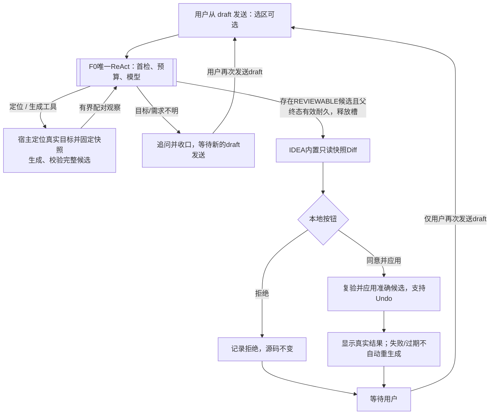

# F2 开发方案：用户本人负责

日期：2026-10-25。状态：开发工作提案，已确认业务约束与待实施技术建议分开；不是正式候选、冻结架构或已实现功能。全部F2任务由用户本人负责，使用既有分支，不向甲乙丙分派实施。

阅读入口：[个人任务组](../tasks/dev-manager/F2/README.md)、[契约提案](../contracts/F2_API_PROPOSAL.md)、[验证矩阵](../tasks/dev-manager/F2/VALIDATION_MATRIX.md)。本公开方案不依赖本地原始答复或忽略文件；原文与来源哈希由负责人本地保管。

## 1. 当前事实与继承边界

本轮本地dev-manager与origin/main均为8fac78899ecffb612f3af9904d220faf1646f692。F0已由用户验收并完成既有PR合入；历史169项测试与IDE证据沿用原交付记录，不算本轮重新执行。当前只有负责人STATUS/HANDOFF有未提交补记，本轮保留。

| 现状 AS-IS | F2所需增量 |
| --- | --- |
| ReactData.Input已有question、code、captureOffsets、captureOrder | 保留混排原文，链接派生目标/源码，不改写用户提交 |
| ReactEngine:112以课程状态统一控制tools；:209使用CourseTools.DEFINITIONS | 按能力独立提供课程、定位、候选工具；错误按工具类型分流 |
| SpringAiCourseModel:38序列化通用工具schema，无内部循环 | 继续由外层唯一ReAct所有者编排，不增加框架隐藏循环 |
| ChatContracts.OperationKind仅GENERATE/COMPACT，事件无F2审核 | 增加独立本地审核事件与应用操作，不复用SubmitDraft/Retry |
| JavaCodeCapturePort只返回选区/方法/类结构 | 新增项目内文字定位及同版完整Document前像，不能拼接片段冒充全文 |
| UI已是MixedDraftEditor与ChatTimeline | 增量提案视图、原生Diff及两个按钮，保留现有输入/IME/滚动行为 |
| ReactRepository拒绝终态Snapshot再次保存 | F2候选、决定、应用事实单独持久化，不能回写终态模型协议 |

保留单插件、纯Java、Spring AI/H2/JVector、现有构建与唯一验证入口。不新增服务进程，不实施F1/JUnit/Git提交消息等功能，不提供任意路径写入、任意命令或代码执行工具。凭据仍走平台凭据服务。

## 2. 已确认目标 TARGET

| ID | 已确认行为 | 主要验收组 |
| --- | --- | --- |
| R01 | 按用户指令修改Java源码，覆盖重构/修bug等有意义场景 | G2/G3/G6 |
| R02 | 选区可省略；可在draft文本指出文件、类、方法及预期行为 | G2 |
| R03 | 应用前使用IDEA内置Diff并排展示真实before与候选after | G4 |
| R04 | 预览不修改项目，比较固定原文及候选副本 | G4 |
| R05 | 批准绑定准确版本；源码或候选变化需重新Diff、重新批准 | G4/G5 |
| R06 | 应用已展示内容，不再调模型；IDE写命令支持Undo | G5 |
| R07 | “已应用到编辑器”和“已保存到磁盘”分别报告 | G5 |
| R08 | 两个按钮准确为“同意并应用”“拒绝”，均不进ReAct | G4/G5 |
| R09 | 只有用户重新在draft发送才再次进入ReAct；拒绝/失败/过期不自动重生成 | G3/G4/G5 |
| R10 | F2由用户本人全权负责，不沿用F0的四人分工 | G0–G6 |

R01/R03来自作业及本轮延续讨论，R02/R04–R09来自用户明确补充/确认，R10来自本轮安排。工具名、表结构、参数和下面的MVP范围仍是实施提案。

## 3. 范围建议及待决项

推荐第一阶段：一个明确的现有Java源文件、一个完整候选整体批准；必要改动必须在明确允许范围内。先不做新增/删除/移动文件、多文件事务、逐块批准、可编辑候选、自动格式化/优化imports、自动编译测试或真实MCP传输。单文件等是推荐实施边界，不能写成用户已经逐项批准。

| 决策 | 推荐提案 | 落定时点 |
| --- | --- | --- |
| D0 个人交付与目录 | 全部责任归用户，dev-manager集中交付；G0先以独立治理PR落精确F2路径归属及可信门禁 | 任何F2产品代码前 |
| D1 编辑范围 | 首版现有单Java文件、整份候选；方法外imports/helper等须有明确范围 | G0 |
| D2 工具方式 | 本地Java受控边界，可接MCP，协议按需引入 | G1 |
| D3 生成方式 | 每个生成工具至多一次tools=[]子请求，父级统一用量/预算/取消，无内部重试 | G1/G3 |
| D4 保存策略 | 应用到Document，按IDE正常保存行为；不额外强制保存 | G0/G5 |
| D5 重启审核 | 原始候选可回看；重新验证当前目标和展示后才可批准，不自动恢复应用 | G1/G5 |
| D6 文字决定 | 本版只实现明确按钮；不把draft文字“同意”自动变成写权限 | G0/G4 |
| D7 有限参数 | 查找候选数/源码大小/工具观察/模型次数与时间均有界，取值以本机测量和回归记录 | G1–G3 |

G0记录实际实施边界和必要更正；未决项不阻止本轮产出方案，但阻止假定已全面批准或正式冻结。

## 4. 主流程与所有者

有选区时使用真实归属和版本；纯文字时模型提出定位线索，宿主在原session所属项目允许源码内有界解析。唯一完整结果直接采集，不额外强制定位确认；同名文件、重载、未找到、索引未就绪、查询截断分别返回明确状态，不猜首个目标。定位工具不授予写权限。

无选区的快照在解析并采集成功时固定，原始提交保持不可变；新增目标、before和范围是有来源的派生观察。保存完整Document before供Diff/复验，模型只看必要范围及有界上下文。已有F0方法/类结构片段不是完整before，需同版补采。

首次课程检索仍按attempt一次；工具观察回完整预算核算，不重做首检。F2无课程库时仍可用，课程检索失败仅隔离课程能力，不把F2错误转为通识成功。课程故障导致旧分支失效时，其候选也失去资格，不因另一分支成功复活。

宿主按原提交、目标/源码修订、指令修订及允许范围分配稳定逻辑生成请求；不同toolCallId不产生新业务请求。对同请求并发、成功后或失败后重复propose，只返回原状态/结果，不再次订阅生成模型；需要真正重新生成时由用户新draft提交。重复工具观察仍分别匹配各自callId。

## 5. 组件与契约提案

| 边界 | 建议落点 | 责任 |
| --- | --- | --- |
| 目标/快照端口 | contract下纯JavaDTO；editor/f2平台适配 | 项目、文件、方法、允许范围及完整before同版 |
| 工具执行边界 | core/react与core/edit | 课程/定位/候选独立能力、有限执行、类型化观察 |
| 候选生成 | core/edit调用既有model端口 | 固定指令/源码，一次无工具子调用，校验后构造after |
| 候选与应用存储 | storage新F2仓储，同一H2 | 候选、审核、应用意图、回执与session根守卫 |
| Diff/审核视图 | ui/f2，现有时间线最小集成 | 内置viewer、固定只读副本、两个本地事件 |
| 受限应用适配 | editor/f2 | 只消费宿主持有的批准产物，IDE写命令内最终复验 |
| 装配 | bootstrap/公共注册 | 注入端口与生命周期，不把UI/editor实现搬到bootstrap规避范围 |

示意调用为resolveEditTarget(requestRef)、proposeCodeEdit(snapshotRef, instructionRef)和宿主applyApprovedCodeEdit(applyId)。第三项不作为模型可调用的写工具暴露；批准不能来自模型approved=true。具体字段见契约提案，G1才更新实际API及源码。

## 6. 状态、存储与上下文

分开保存不可变目标/候选、本地审核状态、应用事实。候选记录其turn/attempt/branch/toolCall及指令来源，完整before/after、范围、版本/哈希。生成完成只到暂存；父有效分支正常终态、候选资格及耐久提交共同成立才可REVIEWABLE。

建议审核状态PENDING/APPROVED/REJECTED/INVALIDATED；应用独立记录INTENT/APPLYING/APPLIED_TO_DOCUMENT/FAILED_NOT_APPLIED/OUTCOME_UNKNOWN/RECEIPT_PENDING，磁盘保存状态另列UNKNOWN/UNSAVED/SAVED。它们是字段提案，不能靠一个“成功”布尔合并。

候选资格提升须和父终态、活跃槽收口在同一H2协调边界验证；保存失败不开批准。审核/应用事实不能追加到已终态ReactRepository Snapshot，应在独立F2记录发布视图。预览/审核检查根LIVE、原instance、候选来源/修订及耐久资格，不要求原生成operation仍活跃；生成及新的APPLY写入分别验证各自operation。

后续模型只在新的draft提交时读取有资格的本地状态事实及明确来源。拒绝/过期/应用事实需进入统一投影和checkpoint指纹，避免摘要仍称“待批准”或“已修改”；事实不恢复失败生成全文、thinking或协议资格。重新读取项目文件是新的有界读取。

删除session清理F2私有原文、产物、审核、协议引用和恢复记录；已修改的用户源文件不属于聊天私有数据，不自动回滚。若删除与写入竞争，先撤销提交资格并收口；必须保留的最小本地恢复票据如何清理由G1/G5明确，不能借恢复旁存复活已删除聊天。项目关闭/停用与迟到回包也复验原实例和operation。

## 7. Diff与本地决定

Diff左右为固定只读before/after，不绑定可直接编辑的live Document。UI只有在候选完整、有效、耐久且展示了准确版本后提供“同意并应用”“拒绝”；关闭viewer只释放视图，不等于决定或继续生成。

批准/拒绝走独立本地ViewEvent/协调器分支，不复用UI send、retryLatest、SubmitDraft或旧ReAct Job。两按钮均要求模型订阅数、嵌入请求数、课程首检数、ReAct启动数增量为0；不得触发自动摘要、模型结果说明或合成用户消息。现有draft不被消费/覆盖。

拒绝、过期、失败、待核对均展示本地真实状态；仅用户再次draft发送可以再定位或生成。既有F0重试语义保持，不能为F2按钮借用空draft触发retryLatest。F2重新生成须新提交，不能从审核按钮续接旧attempt。

## 8. 准确应用与恢复

1. 用稳定applyId去重，先校验项目/session/候选和真实按钮证据。已成功返回历史结果，处理中/待核对返回原状态；新请求才申请本session应用槽。忙时不排队。
2. 验证实际文件归属、可写性、允许范围、当前Document版本和完整before，包括未保存编辑。目标/内容/版本变化使批准失效，不能自动重定位、模糊打补丁或改名。
3. 先耐久保存精确应用意图；失败不执行。进入IDE写命令后再次核验提交资格及基线，只应用已展示after。网络、数据库长事务、模型和等待用户不放在IDE读/写锁内。
4. 获得真实Document结果再保存回执，支持命名Undo命令；后续磁盘保存/Undo是独立可观察事实，不自动重放旧批准。
5. H2与Document不是共同原子事务。结果不明或已应用但回执失败时结束本地执行，保持可见阻塞并只核验补记；重启不自动编辑。匹配内容本身不足以证明本次应用。
6. 所有占槽出口统一收口，终态保存后只释放本操作槽；不能占住旧运行任务等用户，也不能释放其他操作的槽。实际已改不能因后续取消、回复失败或聊天删除而宣称未发生。

## 9. 任务顺序及完成定义

所有组唯一负责人均为用户本人，顺序G0→G1→G2→G3→G4→G5→G6。G0先处理当前F0-only入口与managerExcluded的真实冲突；本轮不改hooks、权限策略、构建、依赖或业务代码，不创建分支/PR。

开发交付完成需范围内实现、统一All、目标IDE必要检查、独立检查、最新PR validation/scope、main合入与核验；用户实际黑盒及真实服务边界单独记录。本轮只完成文档生成与Repository检查，所有F2实现与IDE/API验收为NOT_RUN。

## 10. 官方依据与验证限制

2026-10-25读取的[Documents](https://plugins.jetbrains.com/docs/intellij/documents.html)支持Document内存文本、命令与Undo；[PSI Files](https://plugins.jetbrains.com/docs/intellij/psi-files.html)说明项目作用域PSI与文件查找；[Threading Model](https://plugins.jetbrains.com/docs/intellij/threading-model.html)约束模型访问锁和EDT；[IDEA Diff Viewer](https://www.jetbrains.com/help/idea/differences-viewer.html)说明侧对比及可编辑本地内容。只读副本+显式宿主批准是基于这些能力的本方案设计，不是官方对本插件的保证。

本机仍仅验证实际安装版本，当前既有基线为IU-262.10968.63；未来升级重新读取product-info并同步构建/CI，不承诺其他版本。官方网页和合成模型不能替代本机Diff/Undo/脏文档/取消竞争证据。
