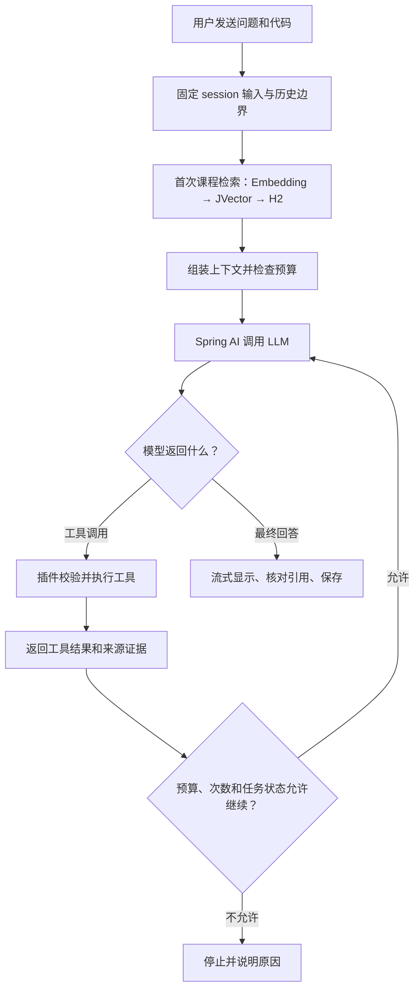

# F0 ReAct 编排设计

更新：2026-10-18（Asia/Shanghai）。主流程由用户在 user-turn-030 采纳，本轮范围由 user-turn-031 重申为 F0。本文的身份字段、工具接口、流式分步和故障分支是实现提案，尚未建立主插件工程、验证真实 API 或冻结架构。

## 1. 已确认流程

首次检索仍由核心保证；模型随后可根据已有信息补查。工具由模型请求、插件执行，工具结果作为观察交回模型。模型正常给出最终回答是成功出口；超限、取消或故障不是成功答案。图是责任顺序，流式的临时显示及最终提交规则见第 4 节。

## 2. 单任务、多步骤（提案）

一次用户提交仍只产生一条原始用户消息、一个 turn 和当前 attempt，占用该 session 的唯一活跃操作。循环不再次消费草稿，不将工具往返变成新的用户提问。用户明确重试才创建新 attempt。

| 对象 | 责任 |
| --- | --- |
| ModelStep | attempt/branch 内一次模型请求，有独立 stepId；该步骤唯一网络订阅，UI/存储只观察核心状态 |
| ToolInvocation | modelStepId、toolCallId、工具名、结构化参数和执行状态；归属由核心上下文绑定，模型参数不决定 session |
| ToolObservation | 配对 toolCallId 的结果、状态和来源；区分成功有内容、正常无命中/未建库与故障 |
| EvidenceSet | 当前分支实际传入模型的固定来源集合；保留 sourceVersionId/chunkId/physicalPage/索引代次，只有可核对的引用能进最终回答 |
| ProtocolState | 模型续接所需的完整工具消息与供应商字段；与普通聊天正文、UI HTML 和历史摘要分开 |

第一版优先串行执行同一模型返回的工具调用，保留每个调用的配对结果；不增加会话内并行调度器。每次执行前校验工具允许范围、参数、来源引用、操作存活与限额。执行完再校验写入权，已删除/取消对象不接回迟到结果。无法完整匹配的工具调用不编造成功观察。

用户将首版能力限定为课程 RAG 与模型基础知识；不另增其他工具能力。工具注册、名称和 Java 方法仍为提案。MVP 可先提供 searchCourse(query) 与 readCourseEvidence(ref)：前者复用查询嵌入/JVector/H2 链路，后者只读已授权的固定课程版本/片段范围。选区/方法/类结构已由提交快照提供；不据工具循环扩大为任意文件读取。直接 Java 回调足以评估，不因 ReAct 自动引入 MCP、独立进程或新的服务。

Spring AI 版本、直接 ChatModel 配合显式循环或受控 ToolCallingAdvisor 的装配尚未选定。整个 attempt 只有一个循环所有者；不能由插件外层循环与框架内部循环各自重复执行工具。协议依据见 `evidence/react-protocol-research.md`。

## 3. 上下文、预算与协议状态（提案）

每次模型调用之前重新核算规则、工具 schema、历史、当前问题/代码、课程证据、完整工具轨迹与必须回传的协议字段，并预留输出预算。循环次数、工具总次数、耗时及结果大小均需有有限配置，具体值由实施验证后回填，不在本稿编造默认数值。达到限制时停止并说明，保留已保存材料，不以无限工具循环或递归摘要兜底。

自动压缩仍只处理较早的已终止轮次；本次活动循环及其中工具请求/结果不进入摘要覆盖前缀，不能截断消息对。已终止轮次压缩前先过滤资格：仅最终耐久成功的有效分支可提供生成正文/工具/协议内容，未完成轮次只保留原用户问题/代码及状态；原始轨迹仍可回看。不能再叠加框架自动历史，使同一原始消息/工具结果被重复注入。

普通聊天的 Markdown 正文不接收 reasoning_content；工具/思考显示到独立可折叠小字区。但带工具的 DeepSeek 思考模式有额外回传要求，协议状态可能跨轮次保留，但后续提问不能纳入中断 attempt 或失效分支的字段；其原文存储、按资格过滤后的投影及模型适配必须验证，不能简单丢弃或用摘要代替必需字段。该约束尚未落实为已验证实现；若预算内无法构造合法输入则停止，不能无提示更换模型/模式或扩大输入预算。摘要模型、Token 预算和压缩失败参数仍由既定任务执行成员确认。

## 4. 流式、结束和生命周期（提案）

“一次订阅”细化为每个 ModelStep 一次订阅；一个 attempt 可串行拥有多个模型步骤。核心为 attempt 的可持久事件分配持续单调 seq，并携带 branchId/stepId，不因换步骤复用旧事件身份。旧步骤回包不能覆盖新步骤状态。

每个模型步骤独立保留正文预览与协议输出。生成中可逐步显示当前步骤的临时 Markdown，但不提前标记最终答案；若结束为工具请求，该正文归到过程预览，不能直接拼入最终回答。切换步骤推进渲染 epoch；最终答案仅来自经过结束验证、无待执行工具调用的最终步骤。工具阶段显示实际执行状态，工具 JSON/推理字段不冒充回答正文。

停止、重试、超限和中断不清除已经生成并渲染的内容；过程、思考和正文继续按原步骤可回看，后续输入资格独立于是否保留显示，见 F0_BEHAVIOR.md。tool_calls 只表示继续到工具阶段。最终步骤需验证正常结束、实际引用和存储提交；仅 Flux onComplete/EOF、无正文或前面某步成功均不足以宣告完成。累计 partialBody 按 attempt/step 保存，旧步骤及旧保存批次不能覆盖最终结果。usage 按模型步骤保留可得统计，缺失仍为 unavailable/null；不将重复整次统计累加成虚假费用。

关闭标签只解除视图订阅，循环继续；重开从核心状态恢复，不重发网络调用。停止、删除 session 或项目实例失效后，不再开始后续模型/工具步骤；来自旧模型/工具回调的迟到回包和私有写入按原规则拒绝；原对象仍存在且未删除时，不阻止协调方有条件保存已接收内容的终止快照。重启不自动续跑工具循环，已保存结果标为中断。session 删除清除全部工具轨迹、协议续接状态、部分输出及私有证据，课程共享资料保留。

## 5. 正常空结果与故障（提案）

无命中/未建库继续采用用户已确认的通识声明；未建库时不提供无意义的补查工具。正常一次补查无命中可作为观察返回模型，并在限额内决定下一步，不将无命中变成异常；此前成功取得的本轮证据不因一次正常无命中而被清空。

开发阶段原始异常传播到任务边界，暴露后修复。实际使用课程检索故障沿用用户确认的“提示后自动通识、未用本轮课程证据”。多步循环需补充分支隔离：若此前证据已进入模型步骤，不能继续原上下文却声称没有使用。优先提案是在同一 attempt 中至多一次进入新的通识 branchId：先使旧分支及其模型/工具写入权失效，再基于冻结的原问题/代码与历史重新组装合法输入，排除本轮课程证据、此前循环的中间输出、工具轨迹及本轮旧分支协议字段，禁用本轮后续课程工具；重新校验预算后执行一次通识结束步骤。原有更早历史按供应商协议验证，不以删字段伪造合法续接。先前轨迹只保留档案，不投进新分支；已有中间预览明确标为失效，正文保存按分支隔离，旧分支不能覆盖新分支。最终 EvidenceSet 为空。该转移有提示和独立分支身份，不重提用户消息，也不作为生成断流后的自动重发；通识分支自身生成失败直接结束，不再次进入通识。

若无法保证通识分支输入隔离、协议合法性或耐久保存，则提示并停止当前任务；不能制造“未使用课程资料”的不实说明。生成断流继续遵守不自动重发；未知工具/无效参数/协议配对错误在开发暴露，实际使用提示并停止受影响循环。上述多步故障处理尚需可控响应验证。

## 6. 接入与验证（未执行）

负责人承接循环编排、工具分派、协议适配、证据和事务，丙呈现步骤进度/临时预览/最终回答；甲乙仍提供既定捕获与 PDF 适配器。权重 5:1:1:1 不变，新增循环成本需实测；不把完整 P0 或真实网关验证全部作为三个适配器开始模拟接入的前提。

至少验证：首次检索不被跳过；零次/一次/多次工具调用；同一返回含多工具时的配对；每步骤只发一次请求；工具与终止原因分离；无命中和异常；追加证据及真实引用；工具结果/协议状态超预算；DeepSeek 及课程网关的准确 tool schema/流式参数聚合/必要字段；分支重建不重放旧证据；关闭重开/停止/删除与迟到回包；重启中断；完整 session 私有数据删除。现有依赖树或单库探针不能证明以上用例通过。

## 7. 工作状态与资料快照

开停入口填写 API key，修改 key 前先停用，依据 user-turn-032；配置冻结、停用取消及再次启用为 `F0_BEHAVIOR.md` 中的实现提案。停用后不开始新的模型/工具/远程嵌入请求，旧 runtimeEpoch 回包失效。

用户指定 MD5 排重，user-turn-033 更正为在资料视图选中资料更换/移除；管理细则见 `COURSE_LIBRARY.md`。attempt 建立时固定库代次，首次检索与所有课程工具沿用；资料更换/移除后的新 attempt 才消费新活动集合；历史和在途证据继续对应固定版本，不混入新版本片段。

## 8. 第三组实施回填（2026-10-18）

已落实显式单所有者循环、固定 lease 首检/工具、完整参数批前校验、步骤/协议分离、有限预算/次数/大小/耗时、产品故障独立通识分支、最终实际证据引用和 H2 累计档案。Spring AI 保留在请求/消息/工具类型及 HTTP 装配，严格 SSE 边界保留未知终止与原始转换异常；不叠加框架循环/重试。取消与最终保存以原子决定排序，未执行工具仍保留可回看状态。接入及测试候选参数见 [WORK_GROUP_3](../tasks/dev-manager/WORK_GROUP_3.md)，真实结果看 STATUS；本回填不冻结架构，也不将合成协议等同真实平台能力。完整 session/压缩及生产配置/根 guard 接线仍属第四组。
