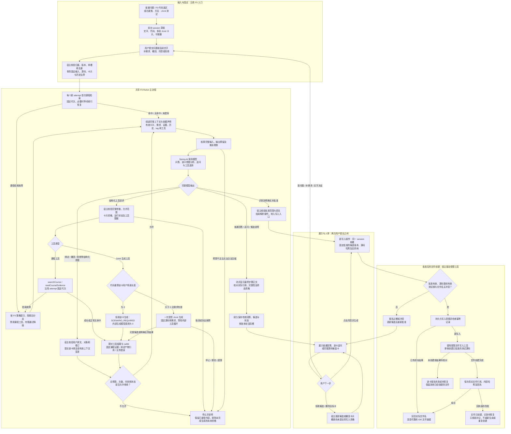

# F0 + JUnit 完整业务流程图（讨论稿）

日期：2026-10-20（Asia/Shanghai）。绘图请求：[user-turn-048](user-turn-048.md)。F0依据：[原图源](../diagrams/f0-react.puml)与[ReAct细则](../REACT_ORCHESTRATION.md)。JUnit行为依据：[041](user-turn-041.md)、[042](user-turn-042.md)；按F0节点分类依据：[047](user-turn-047.md)。

## 完整流程

## 图的范围与约束

- 这是一张以F0主线组织的扩展讨论图。用户明确的JUnit多卡/需求/追问/撤回/批准创建/跳转行为与代理提出的具体执行机制并不等价于全部确认；现F0原图、产品代码及WORKING未修改。
- F0入口、attempt固定输入/代次、首次课程检索、完整上下文预算、Spring AI、有限工具循环、正常终态/引用/耐久提交仍在图中。初始检索按attempt一次，预算每模型步骤重新核算。
- 无命中、未建库、命中和课程检索故障各有依据声明；恢复中不能冒充无库。取消不是检索故障，直接撤销任务资格。
- 课程故障支路仅描述课程能力。普通F0仍按既有隔离/有限通识规则处理；JUnit等新增能力的可用性不应仅由hasMaterials决定，具体按任务策略独立控制属于扩展提案。
- 图中的“结构化意图”是计划的受控输出/命令边界，具体schema/工具形式尚未选定。模型提出绑定、撤回和文字决定，宿主核验真实用户来源、明确对象与修订后执行。
- 三张卡中A/B明确可先生成候选，C缺失单独追问。每卡检查真实用户场景；0拒绝该卡生成，模型不能自行补造用户需求。实际执行先串行，逐卡状态与整体attempt资格需共同设计，不能把一个完整子输出自动当有效最终产物。
- JUnit工具内部一次无工具模型调用仍由外层唯一编排者管理，次数/用量/耗时计入同一总限额；没有第二个工具循环、第二个session或隐式重试。
- 工具结果严格配对模型toolCallId。测试产物引用不能冒充课程证据。开发原错、协议故障、取消、断流/超限分别到明确任务边界，不能一概转通识或伪装正常空结果。
- 流式显示可提前预览；只有完整、有效且耐久的候选可批准。最终回答中的课程引用只认可实际传入最终步骤的固定证据。
- 等待补需求或批准位于两次提交之间，不挂住活跃Job。用户补充/撤回对应新的输入和有效卡片投影；被撤回内容从后续模型/摘要/checkpoint中排除，原档案保留标记。
- 按钮批准直接进入宿主新写入操作，无需重新首检或LLM。文本批准经解析、宿主核验并结束解析操作后汇入同一入口；不会在同一session同时占两个槽。多意图一条消息时先校验一致的操作计划，再分别执行；歧义先澄清。
- 写入批准绑定已经展示的完整源码与计划位置，不在批准后重新生成代码。测试根、文件名、源码/需求或候选修订变化使旧批准失效。
- create-only/不覆盖、一候选一文件、精确版本/哈希、幂等及恢复均为本轮保留的实现提案。无测试根/多根未选择、已有文件、跨卡同路径需明确处理，不能自动改名或覆盖。
- 写入不承诺与H2共同原子提交；文件已创建、回执失败时保留事实并恢复记录，不盲目重试创建。匹配文件但缺可靠回执只能报告检测到匹配文件/待核对，不能伪造创建者。
- 文件结果逐卡报告；其他卡失败、外层回复停止或聊天删除不自动删除已创建的项目测试文件。后续需要读该文件时，通过新有界读取取得当前内容；写入事实不恢复失败生成协议资格。
- 已有成功writeId直接返回原结果，重复批准不重复创建。链接由真实IDE文件引用构造，并在点击时检查项目与文件存在性。
- 本图不展开全部数据库恢复/删除算法或IDE线程API；这些沿用/扩展既有任务边界，不因绘图宣称通过实现验证。
- 图源：[f0-junit-complete-2026-10-20.mmd](f0-junit-complete-2026-10-20.mmd)。未调用外部渲染服务，未执行产品/IDE/API场景。

本轮继续按user-turn-044记录evidence并更新来源哈希；不生成正式候选或冻结状态。
