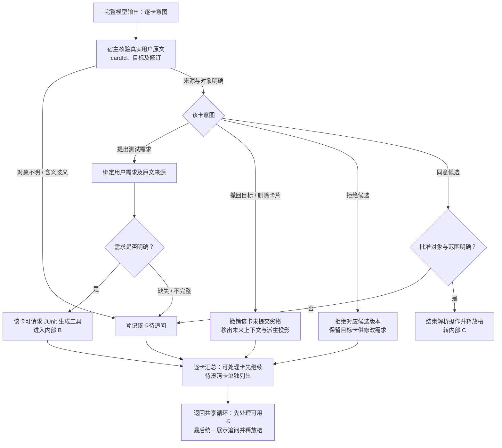

# 内部 A：多卡意图、需求绑定与撤回

日期：2026-10-20（Asia/Shanghai）。这是既有讨论方案的分图，尚未实施或冻结；本轮仅改变图的层次与展示，未增加用户已确认的产品要求。

入口是[主图](f0-junit-main-2026-10-20.md)中的模型意图处理。目标身份与源码快照在提交前固定；此处处理用户需求的语义归属。结构化意图的具体schema/命令形式仍为提案。

三卡A/B需求明确、C不明时，A/B可继续生成候选，C单独追问。卡片序号与身份保持稳定，不能因删除或缺少说明而将C的需求错绑给B；模型推测不能代替用户要求。

撤回清除未来模型、摘要与checkpoint中的对应有效投影，保留带撤回标记的原始档案；已远程发送的上下文无法撤回。拒绝候选与撤回目标分开，均不自动删除已创建测试文件。迟到捕获/生成结果不能复活撤回卡。

同一session先串行处理，汇总不意味着绕过父操作终态资格。A/B候选仍需完整、校验和耐久收口才能批准。待处理卡完成后统一展示追问并结束当前操作；补充/撤回是新输入，不是重试原来的空场景调用。歧义文字批准先澄清，无歧义再转[内部C](f0-junit-internal-write-2026-10-20.md)。

图源：[f0-junit-internal-intent-2026-10-20.mmd](f0-junit-internal-intent-2026-10-20.mmd)。
