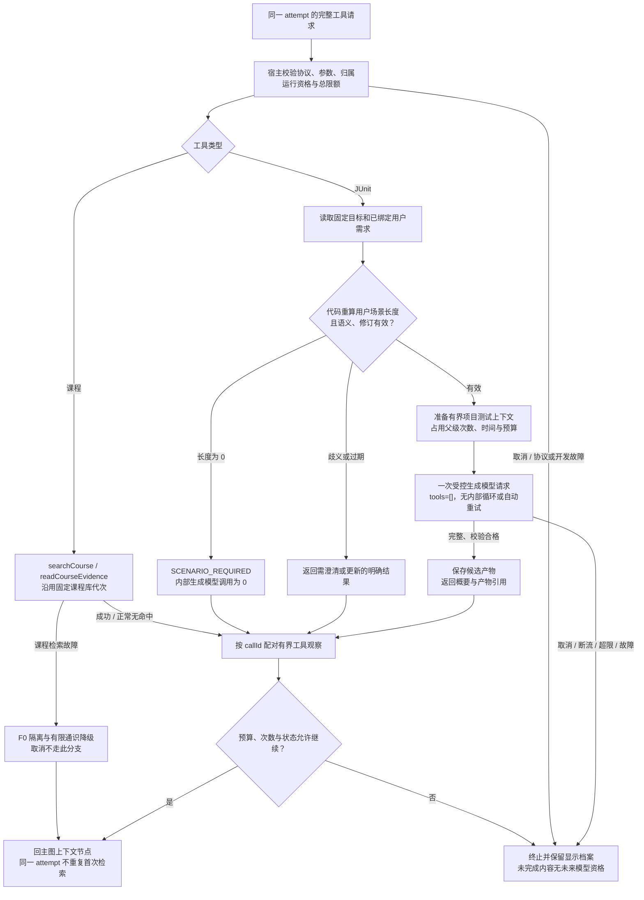

# 内部 B：ReAct 课程与 JUnit 工具处理

日期：2026-10-20（Asia/Shanghai）。这是既有讨论方案的分图，尚未实施或冻结；本轮仅改变图的层次与展示，未增加用户已确认的产品要求。

入口来自[主图](f0-junit-main-2026-10-20.md)的完整模型工具请求；外层始终是唯一ReAct循环所有者。结构化意图先按[内部A](f0-junit-internal-intent-2026-10-20.md)核验，只有实际tool_call才产生配对tool观察，不为宿主命令伪造tool消息。

代码从每张卡真实绑定的用户测试需求计算长度；不计系统提示、源码、tag或模型补写的场景。长度0必须在生成模型订阅前拒绝；长度正数只证明非空，不证明需求明确。模型不能自行提供长度/批准标记取得执行资格。协议按需接入，工具边界仍可先是纯Java。

JUnit内部一次无工具生成沿用父操作的取消、次数、时间与用量预算，不占第二个session槽。目标项目的测试配置通过有界读取获得，不以插件测试依赖代替，不自动改构建或运行任意代码。失败不得当作课程检索故障降级为正常空结果。

课程检索故障按既有F0策略隔离旧分支并有限降级；JUnit能力须按独立策略判断，不能仅由课程库是否存在决定。预算不足且无法合法压缩时从主图直接结束，不启动模型步骤。

图中的“保存候选”指完整产物暂存；外层终态有效及耐久收口共同成立后才可批准。流式中断预览只留显示档案，不因有产物引用就获得未来上下文资格。

图源：[f0-junit-internal-tools-2026-10-20.mmd](f0-junit-internal-tools-2026-10-20.mmd)。
