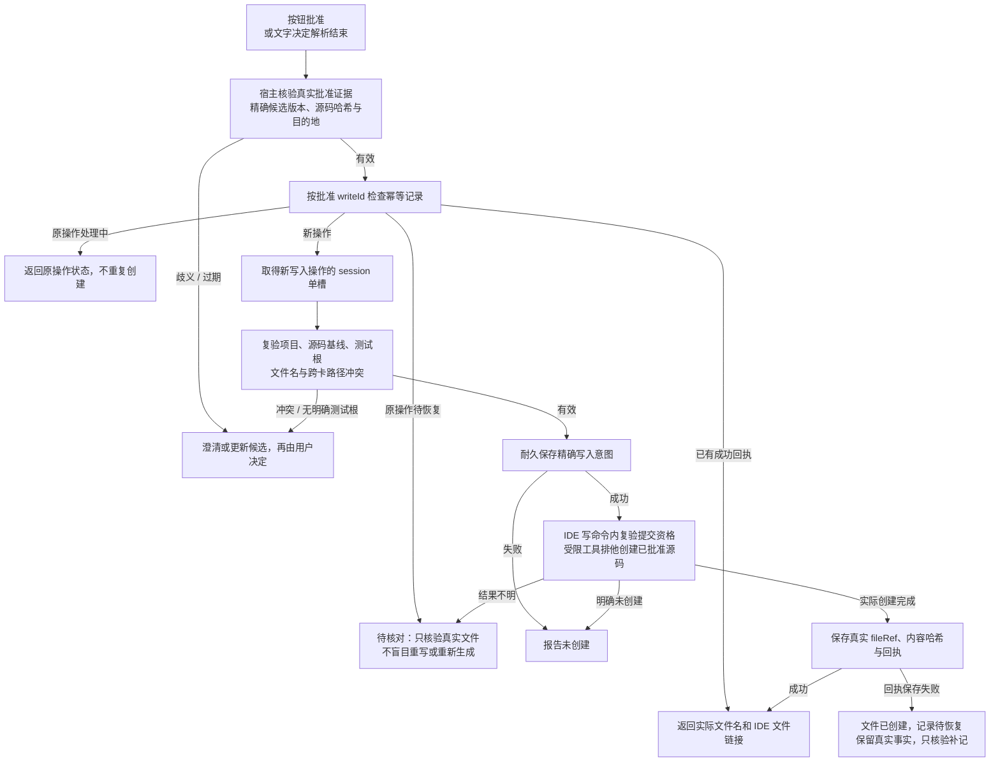

# 内部 C：用户批准与测试文件创建

日期：2026-10-20（Asia/Shanghai）。这是既有讨论方案的分图，尚未实施或冻结；本轮仅改变图的层次与展示，未增加用户已确认的产品要求。

入口来自[主图](f0-junit-main-2026-10-20.md)的“同意并生成”按钮，或已完成文字批准解析的操作。用户要求候选经同意后调用文件工具并提供实际文件链接；以下精确票据、仅新建、幂等与恢复细节继续作为代理实现提案。

批准前展示完整测试代码、目标/需求以及明确的模块测试根与文件名。批准绑定该版本与位置；源码、需求、候选或目的地变化使旧批准失效。批准后写入既有产物，不重新让模型生成。宿主读取writeId绑定的受控内容与路径，不接受模型任意路径/代码或自报approved=true。

每候选一文件、仅新建不覆盖为现有最小范围提案；无测试根、多根未选、已有同名文件或跨卡冲突时先说明。文件写入边界必须验证实际归属及链接逃逸，持久意图保存失败不能开始创建。

文件系统与H2不保证同一原子提交。文件创建而回执失败时保留真实事实并核验补记；重启只核对，不自动续写。已有匹配内容但无可靠创建回执，不能声称本次创建。多卡逐项反馈，不以删除成功文件模拟回滚。

停止/撤回只在取得提交资格前阻止新建；实际创建后应保存文件事实，即使外层回答停止。文件事实与失败生成的协议/历史资格分开。链接来自真实IDE文件引用，点击时检查项目与文件存在性。

图源：[f0-junit-internal-write-2026-10-20.mmd](f0-junit-internal-write-2026-10-20.mmd)。
