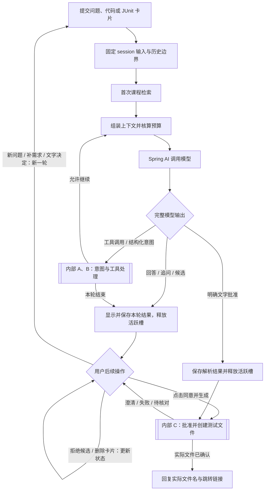

# F0 + JUnit 主流程（精简讨论图）

日期：2026-10-20（Asia/Shanghai）。这是既有讨论方案的分图，尚未实施或冻结；本轮仅改变图的层次与展示，未增加用户已确认的产品要求。

根据[本轮拆图请求](user-turn-049.md)，将[上一版完整图](f0-junit-complete-2026-10-20.md)拆为主图与三个内部图。F0主线依据[原图](../diagrams/f0-react.puml)，JUnit需求依据[user-turn-041](user-turn-041.md)、[042](user-turn-042.md)。

- [内部 A：多卡意图、需求绑定与撤回](f0-junit-internal-intent-2026-10-20.md)
- [内部 B：ReAct 课程与 JUnit 工具处理](f0-junit-internal-tools-2026-10-20.md)
- [内部 C：用户批准与测试文件创建](f0-junit-internal-write-2026-10-20.md)

主图保留F0的固定输入、首次课程检索、上下文预算、模型调用、工具循环及显示保存；内部故障出口在子图展开。首次检索按attempt一次，工具观察返回上下文预算，不回首检。普通回答展示后可结束；候选等待、追问等待不占活跃槽。

按钮批准直接进入内部C。文字批准先由模型提出解释，宿主核验用户原文，结束解析操作并释放槽后再开始写入操作；主图已明确显示解析与写入之间的交接节点。拒绝/删除动作必须核验明确对象，不能误删其他卡或项目文件。

主图的“显示并保存”是展示与终态收口的概括：流式预览可提前显示，只有完整、有效、耐久的候选可批准；保存失败须按F0阻塞与恢复处理，不能宣称已释放成功或已批准。内部停止/失败记录保持原资格，不混入有效历史。

图源：[f0-junit-main-2026-10-20.mmd](f0-junit-main-2026-10-20.mmd)。未调用外部渲染服务；未执行IDE/API/产品场景验证。
