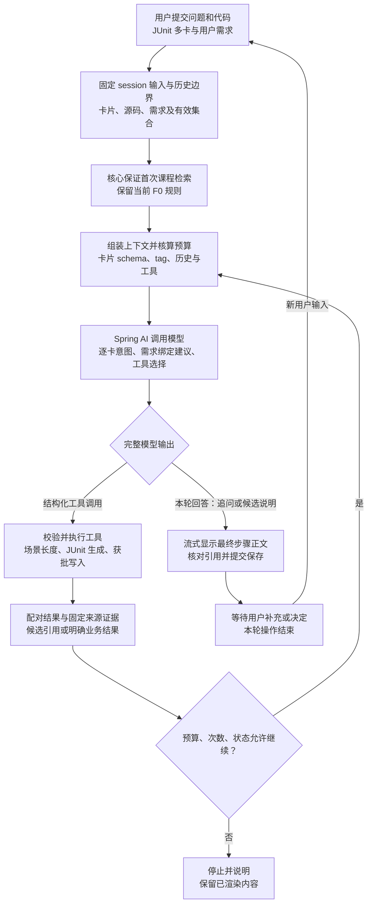

# 按 F0 流程图节点分类 JUnit 流程（讨论稿）

日期：2026-10-20（Asia/Shanghai）。用户澄清见[user-turn-047](user-turn-047.md)，原分类请求见[user-turn-046](user-turn-046.md)。本条改为依照F0流程图具体节点分类，代替本轮先前仅按Reason/Act/Observe和模块职责展开的交付视角；原记录保留，不改写用户原文。

## 分类依据

- [F0有限ReAct图源](../diagrams/f0-react.puml)：用户提交问题和代码 → 固定session输入与历史边界 → 首次课程检索 → 组装上下文预算 → Spring AI调用模型 → 课程工具请求判断 → 校验执行 → 配对结果/固定证据 → 限额/状态判定 → 再请求或停止 → 最终步骤显示与核对保存。
- [REACT_ORCHESTRATION已确认流程](../REACT_ORCHESTRATION.md)：同一主线的Mermaid表达。
- 原F0图、原源码和正式架构状态本轮不修改。下列JUnit能力仍是扩展设计，不能据归类宣称已经实现。

## 逐节点分类

| F0 流程图节点 | JUnit 流程归类 |
| --- | --- |
| 图前：编辑器交互 | 右键类/方法、捕获快照、多卡增删；这些发生在模型请求之前。 |
| 用户提交问题和代码 | 提交JUnit卡片及测试需求；补充需求、文本同意/拒绝是后续用户输入。 |
| 固定 session 输入与历史边界 | 固定cardId、源码/需求修订、候选版本；确定有效卡片集合，排除撤回卡片。 |
| 核心保证首次课程检索 | 沿用现有F0首检规则；JUnit是否另设检索策略需另行决定，本次不改变。 |
| 组装上下文并核算预算 | 放入有效卡片schema/tag、用户需求、固定源码、合法历史和可用工具定义，计算完整预算。 |
| Spring AI 调用模型 | 逐卡分析意图、提出需求绑定、决定追问哪些卡，以及请求JUnit生成工具。 |
| 完整输出：工具请求或最终回答 | 生成请求进入工具分支；缺需求的追问、候选说明进入本轮回答分支。模型意图不直接授予写权限。 |
| 校验并执行工具 | 代码重算场景长度、核对请求资格；执行JUnit生成工具。获批文件的创建工具也属于此类执行能力，批准校验由宿主完成。 |
| 配对结果与固定来源证据 | 返回测试候选引用、SCENARIO_REQUIRED等业务结果；有模型tool_call时严格配对callId。按钮直接写入的回执属于宿主事件，不伪造孤立tool消息。 |
| 预算 / 次数 / 状态允许继续 | 检查同一attempt的模型/工具次数、累计用量、剩余时间、取消和卡片资格；子生成也计入总限额。 |
| 停止并说明，保留已渲染内容 | 超限、停止和故障保留对应状态/前缀，未来输入资格仍过滤；已创建文件的事实另行保留。 |
| 流式显示最终步骤正文 | 显示针对缺失卡片的追问、完整候选及同意/拒绝入口；文件创建后显示实际文件名跳转。 |
| 核对引用并提交保存 | 保存本轮有效回答/候选和状态；创建文件另保存真实回执，不能用回答SUCCEEDED代替文件已创建。 |

## 在同一 F0 主线上标注

上图的“获批写入”表示工具执行能力的归属位置，不要求每次点击批准都先请求模型。按钮可由宿主直接走批准校验→文件工具→真实回执→UI通知；只有确实由模型发出且配对的调用才进入模型工具协议。文字决定可先经模型识别，再由宿主核验原始用户输入与精确候选版本。

## 两个需要单独标记的扩展点

1. **图前准备与图后等待**：多卡片增删属于提交前交互；追问和候选展示后等待用户属于两次提交之间。本轮任务正常结束，不保留一个ReAct Job跨人工等待。
2. **候选批准与文件事实**：F0图原本只描述回答完成。JUnit新增待审批候选和文件创建回执；批准属于新的用户决定，候选耐久完成与文件真实创建分别记录。

## 用户示例映射

三张卡中A/B需求明确、C缺失：在“Spring AI调用模型”节点提出A/B绑定并识别C缺失；A/B的JUnit调用走工具分支，C的追问走本轮回答分支。用户下一轮补充/撤回C时，重新进入“用户提交→固定边界→组装上下文”。用户批准A/B后，受限文件创建能力归于“校验执行工具”，真实文件结果归于回执/显示保存。

需求映射建议、具体绑定落盘、场景长度0、批准版本/路径校验等仍由宿主在执行边界核验；不能把模型生成的意图当作已经完成的确定性修改。撤回内容需从后续模型投影与派生缓存中排除，原始档案保留标记。

## 源码定位

- ReactEngine.java:99-113：首检与上下文规划；118-131：模型步骤及最终提交；138-170：工具校验、执行和结果配对；193-209：资格与请求；231以后：模型流式采集。
- SessionCoordinator.java:174、214：提交生命周期和运行装配；ReactContext.java:32：工具协议配对。
- JUnit子模型属于“执行JUnit工具”的内部实现，不替代外层“Spring AI调用模型”的唯一循环所有权；具体调用次数与耗时仍受同一任务限额约束。

本轮只分类和记录证据，不增加真实MCP依赖、修改F0首检策略、实施产品功能或更新WORKING.json。
