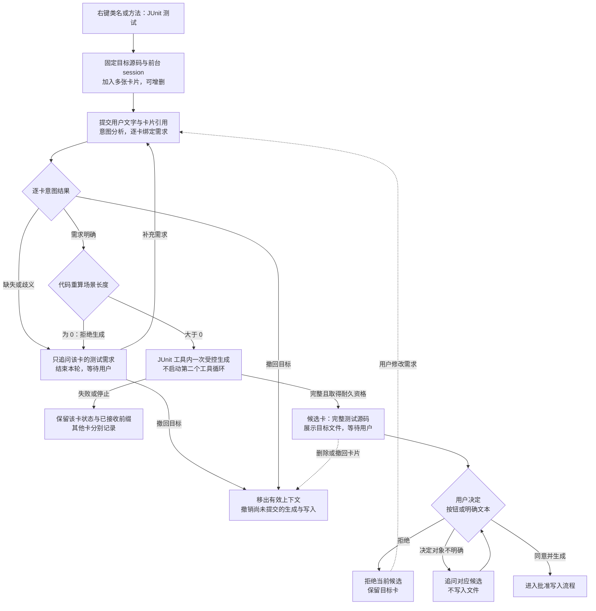
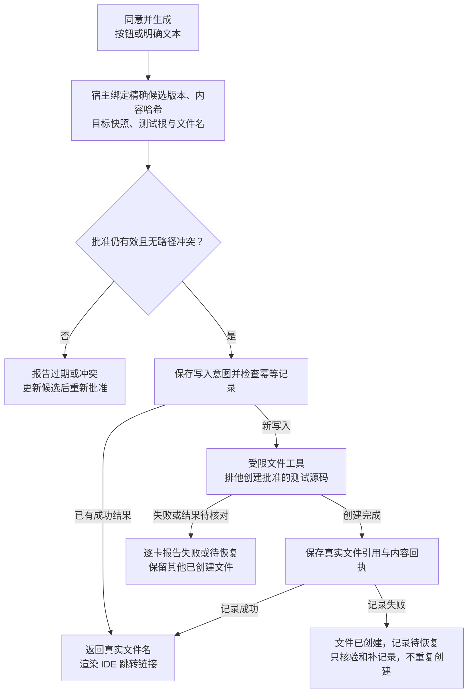

# F1 JUnit 多卡流程图（讨论稿）

日期：2026-10-20（Asia/Shanghai）。绘图请求见[user-turn-045](user-turn-045.md)；业务输入见[user-turn-041](user-turn-041.md)、[user-turn-042](user-turn-042.md)，MCP定位见[user-turn-039](user-turn-039.md)。

这是讨论流程图，尚未实施，也不是正式冻结架构。多卡、逐卡需求/撤回、用户决定后创建测试文件和可跳转文件名来自用户；内部一次受控生成、精确批准版本、幂等/排他创建、仅新建、路径冲突和恢复流程仍为代理实现提案。

## 多卡与需求、候选决定

## 批准后的文件创建

## 阅读约束

- 第一张图按每张卡独立判定。A/B需求明确可以推进候选，C缺需求只追问C；同一session实际生成先串行。
- 等待用户补充或批准时，不保持活跃后台Job。后续文字是新一轮输入，仍绑定原cardId及明确修订。
- 场景长度仅从绑定的真实用户需求计算；0拒绝该卡生成，内部生成请求数为0；正长度不代替语义明确性。
- 用户文本决定先经意图分析并校验来源/范围，再与按钮决定归一。尚无候选的卡、新出现的修订不被“全部同意”隐式包括。
- 流式预览未获耐久资格时不能批准；批准写入的是已经展示的原始源码，不在批准后由模型重写。
- 撤回移除下一次有效模型投影及派生摘要/缓存中的对应上下文，原始档案仍标记保留。已经发送远端的内容不能撤回。
- 候选内容、源码基线或计划位置变化后旧批准失效；已有文件或不同候选同路径不能自动覆盖/改名。
- 各文件逐项报告结果。写入提交前撤回可阻止创建；创建完成后保存真实事实，不因回复失败、停止或其他卡失败而删除文件。
- H2与文件系统不共用原子事务；匹配文件但缺可靠回执时只报告匹配/待核对，不伪造创建者。恢复不自动生成或重复写入。
- 文件名链接由真实IDE文件引用构造，不使用模型编造的路径作为已创建证明。
- 图源：[多卡流程](f1-junit-overview-2026-10-20.mmd)、[批准写入](f1-junit-write-2026-10-20.mmd)。Markdown包含相同图源以供会话/编辑器渲染。未调用外部渲染服务，也未声称已验证真实IDE交互。
