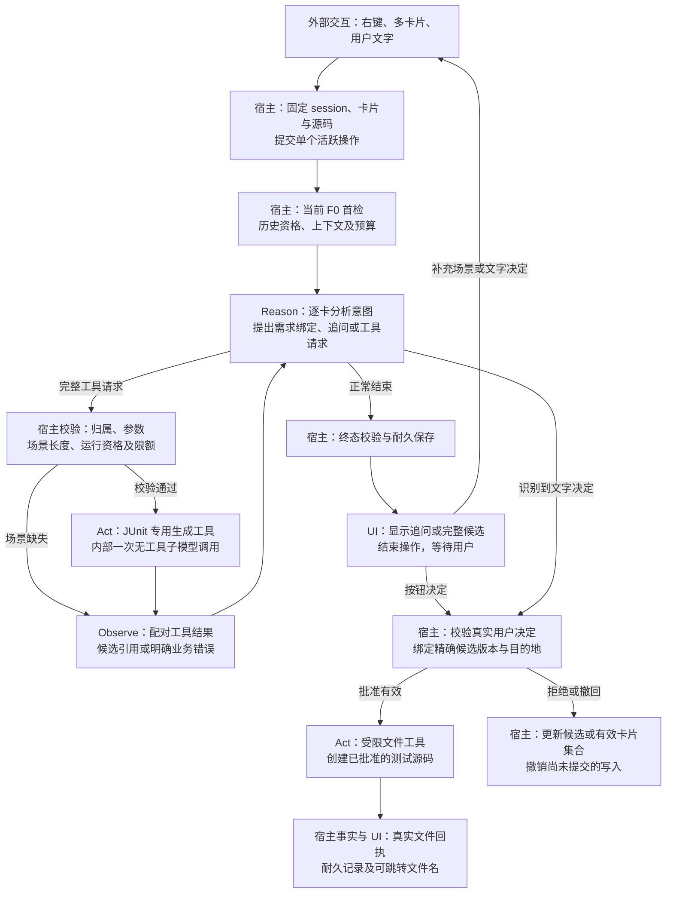

# JUnit 流程按当前 Java ReAct 框架分类（讨论稿）

日期：2026-10-20（Asia/Shanghai）。用户请求见[user-turn-046](user-turn-046.md)；被分类的流程见[上轮流程图](f1-junit-flow-2026-10-20.md)。

本轮是按当前实际代码作职责映射，不能据此声称JUnit、多卡、审批或文件写入已经实现。Reason表示模型生成决策/请求，不要求额外输出内部思维。模型工具执行循环仍由ReactEngine唯一所有者驱动。

## 职责分类

| 原流程内容 | 分类 | 当前可复用边界及增量 |
| --- | --- | --- |
| 右键类/方法、固定前台session、捕获代码、多卡增删、原始文字提交 | 外部IDE/UI与宿主输入准备 | SessionCoordinator已有提交/采集生命周期；JUnit完整目标和多卡schema仍需新增。 |
| 固定目标身份、冻结输入、首检、历史资格、预算、压缩 | 宿主前后置协调 | SessionCoordinator.start、ReactEngine.run/request、ReactContext、ContextPlanner已有机制；现Input只有question/code，不含逐卡需求/批准。 |
| 分析逐卡需求、提出需求映射、决定追问/工具调用、识别文字决定 | Reason（一次ModelStep中的决策） | ReactEngine.collect + SpringAiCourseModel已有通用模型请求；JUnit意图映射及输出校验需新增。 |
| 提交需求绑定/撤回、校验参数/长度/资格、记录明确用户决定 | 宿主确定性命令/执行边界 | 模型只能提议语义绑定；目标身份在调用前固定，需求语义由模型分析后由宿主校验/保存。不能把两种绑定混为同一时点。 |
| JUnit生成工具及其一次受控无工具子调用 | Act（模型请求工具后的执行） | 对应ReactEngine工具校验/串行执行区；现有只执行CourseTools。工具内子模型仍是该Act实现，不另开ReAct循环。 |
| 完整候选引用、场景缺失、生成失败等结构化结果 | Observe（模型工具观察） | ToolTrace及assistant tool_call / tool结果配对机制可复用；候选引用需扩类型，不能当课程Evidence。 |
| 正常结束、正文/证据/状态耐久、取消/超限、后续资格 | 宿主终态与持久化 | ReactRepository/ReactData.Snapshot/ReactContext已有机制；逐卡候选/审批/写入回执与策略指纹需要扩展。 |
| 候选显示、按钮/文本输入、等待、实际文件链接 | UI与人类交互 | ReactViews提供现有累计视图转换；当前主ToolWindow仍占位，新的卡片和审批UI尚未实现。 |
| 用户批准后执行文件创建、保存实际文件事实 | 宿主命令 + 工具Act + 宿主结果事件 | 当前OperationKind只有GENERATE/COMPACT。需新增受控写入生命周期；按钮路径无需额外模型轮次。 |

## 分类图

## 与当前源码的对应

- [SessionCoordinator:174](../../../src/main/java/edu/courseassist/core/session/SessionCoordinator.java#L174)：提交/重试/手动整理；[214](../../../src/main/java/edu/courseassist/core/session/SessionCoordinator.java#L214)：组装上下文与启动ReactEngine。
- [ReactEngine:99](../../../src/main/java/edu/courseassist/core/react/ReactEngine.java#L99)：宿主先保证课程首检；[118](../../../src/main/java/edu/courseassist/core/react/ReactEngine.java#L118)：完整请求预算和ModelStep；[138](../../../src/main/java/edu/courseassist/core/react/ReactEngine.java#L138)：校验工具批次并串行执行；[164](../../../src/main/java/edu/courseassist/core/react/ReactEngine.java#L164)：观察及配对消息；[123](../../../src/main/java/edu/courseassist/core/react/ReactEngine.java#L123)：正常结束与终态提交。
- [SpringAiCourseModel:38](../../../src/main/java/edu/courseassist/model/SpringAiCourseModel.java#L38)：一次模型订阅、函数定义及流式tool调用转换，无内部工具循环。
- [ReactContext:32](../../../src/main/java/edu/courseassist/core/react/ReactContext.java#L32)：严格工具请求/结果配对；[ReactData:74](../../../src/main/java/edu/courseassist/core/react/ReactData.java#L74)：回答输入资格；[ReactRepository:54](../../../src/main/java/edu/courseassist/storage/ReactRepository.java#L54)：终态及事务栅栏。
- [ReactViews:12](../../../src/main/java/edu/courseassist/core/react/ReactViews.java#L12)：现有累计视图；[BootstrapToolWindowFactory:12](../../../src/main/java/edu/courseassist/bootstrap/BootstrapToolWindowFactory.java#L12)：成员UI尚未替换的占位入口。

## 容易误分的地方

1. 宿主预先固定的是项目/session、卡ID、目标快照及原始输入。模型随后分析“哪段需求属于哪张卡”，宿主校验后保存需求绑定；不能声称所有需求绑定已在Reason之前完成。
2. 追问作为本轮正常回答结束；用户补充启动新的turn/attempt，等待期间不占活跃槽。
3. 第一次课程检索是当前F0宿主规则，位于模型决策之前。图保留它以忠实说明现有框架；是否为JUnit任务另设检索策略是独立提案，未在本轮改变。
4. 场景长度等硬校验在Act前的宿主边界。长度0返回明确业务拒绝并触发追问，JUnit子模型调用数为0。代码原始错误/协议故障仍传播明确边界，不能把任何异常都画成普通观察或通识降级。
5. JUnit工具内一次tools=[]子模型生成仍归属Act。不同模型调用可以共享一个任务预算，但只有一个ReAct循环所有者。
6. 按钮批准属于外部人类输入；宿主可直接执行受限文件工具。文本批准可先由Reason识别，但真正写入仍校验真实用户原文、准确候选版本和目的地。
7. 文件工具结果在概念上是执行观察；直接按钮路径记录的是宿主文件事实事件。只有确有assistant tool_call并配对callId时才写模型role=tool消息，不把按钮回执插进已结束协议或制造孤立tool消息。
8. 现有SUCCEEDED/eligible描述生成回答耐久成功，不表示测试文件已创建。候选可审阅与文件创建完成是两个生命周期；写后事实不因回复失败倒退，也不使失败生成内容重新合格。
9. 工具可用性目前依hasMaterials，所有工具失败按课程检索处理。扩展JUnit时需独立能力与错误策略，不能把未建库变成JUnit禁用条件。
10. 本图分类不把MCP当新的推理框架。未来MCP适配只替换工具传输/执行边界，模型仍用当前ReAct编排。

本轮图文和代码观察是代理分析；不构成新增实现授权、正式候选或冻结。未修改产品代码、公共契约或WORKING.json。
