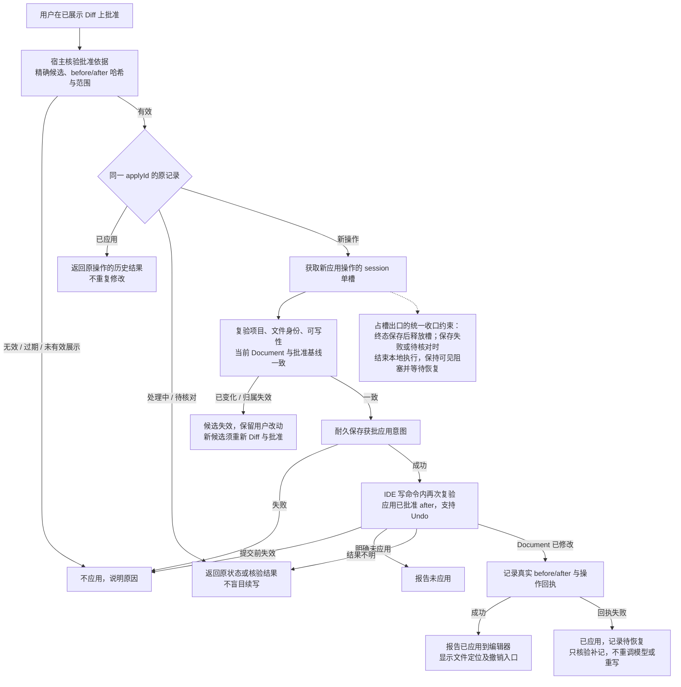

# F2 内部 B：批准后应用及结果恢复（代理提案）

日期：2026-10-24（Asia/Shanghai）。返回[主图](f2-code-edit-main-2026-10-24.md)。这里是受限源码修改工具，不是JUnit仅新建测试文件工具；目标为获批的现有文件。

批准必须来自宿主收到的真实用户事件，绑定已有效展示的精确候选及before/after/范围；模型自报approved=true无效。已批准后不再调模型改代码，不暗中格式化/优化imports引入未展示差异。

同一applyId重复批准在新槽申请前检查去重：已完成返回历史结果，处理中或待核对返回原状态；新申请忙时明确拒绝且不排队。原结果不因用户Undo或后来编辑而再次写回。历史回执不代表当前文件仍与after相同。

基线使用当前Document及稳定文件归属，包括用户未保存的文字，不能只比磁盘。批准前可标出过期；IDE写命令执行前仍须复验原文件、项目实例、session/操作资格、可写性、Document版本及内容。首版保守拒绝版本漂移，不自动挪范围、合并或覆盖用户后改内容；新候选需重新生成、Diff与批准。

所有已取得新操作槽的出口均需收口：终态保存后释放本操作槽；保存失败或结果待核对时结束本地执行，保持可见阻塞并等待恢复，不能挂住仍在运行的任务等用户。恢复只核验/补记本地状态，不自动重放编辑，也不能释放别的操作所占的槽。

应用意图先耐久保存，失败不写；不在持有数据库事务/PSI读锁时等模型、网络或用户。写命令内再次复验并只应用既定after；首版单文件方案支持命名Undo命令，但不能宣称跨重启Undo或文件系统/H2共同原子提交。具体取消与提交竞争须在实现时验证明确边界。

成功如实报告“已应用到编辑器”，文件是否保存独立显示，保存遵循IDE及用户行为。若写入结果不明或回执失败，保留真实状态、阻止盲目重放，后续只核验补记。重启不自动应用；仅发现内容匹配不能推断一定是本次操作写入。

停止/撤回在提交前可阻止应用；实际修改后保留真实事实，不因外层回复失败或聊天删除而自动回滚用户项目。文件/编辑事实单独投影，不使失败生成正文、工具协议或摘要重新合格。用户后续Undo也是新事实，不静默重放旧批准。

图源：[f2-code-edit-internal-apply-2026-10-24.mmd](f2-code-edit-internal-apply-2026-10-24.mmd)。自动保存、多文件原子性/部分成功与逐块批准未在此图假定支持。
