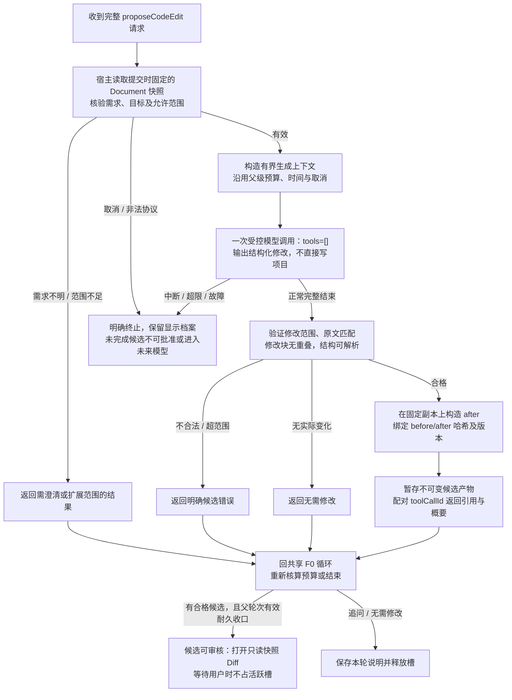

# F2 内部 A：候选生成与校验（代理提案）

日期：2026-10-24（Asia/Shanghai）。返回[主图](f2-code-edit-main-2026-10-24.md)。此图是实现边界建议，不是已确认设计或现有产品能力。

1. 目标在动作开始绑定原项目/会话，提交固定用户指令、文件身份、Document版本和范围。缺少明确意图或上下文时先追问；不机械复用JUnit专属“场景长度为0”字段，也不让模型补造用户要求。
2. 首版从单个已明确文件开始。保留固定整文件before供宿主核验和构造Diff；模型上下文仍按允许范围及预算限定。需要其他范围/文件先让用户明确，不偷偷扩大读取或写入。
3. 修改请求可用固定范围的beforeText/afterText列表表示。宿主验证前像精确匹配、修改块不重叠、未越过允许范围，并在副本上计算最终after，未改区域逐字保留。不以模糊搜索、自动补丁修复、自动重试掩盖无效候选。
4. 内部模型调用至多一次、tools=[]、无递归循环，统一计入父调用预算/时间/用量，取消传播到父操作。课程工具失败仍按课程策略处理；F2故障不包装成课程通识成功。
5. 候选绑定proposalId/revision、原文/结果哈希及范围；解释与代码分开保存。基础检查只报告实际做过的部分，不据此声称编译或测试通过。生成未正常结束时仅保留不可批准的显示预览。
6. 外层父操作的有效正常终态和耐久存储共同成立后，才开启可批准的完整Diff。父轮次失败/保存失败不能由一个完整子候选恢复资格。展示失败不默认批准，允许用户重开同一有效候选。
7. Diff左右两侧为固定只读副本，左为采集时原代码，右为宿主构造的最终建议。不能将可编辑的真实Document交给Diff的直接应用按钮绕过批准；更改候选必须生成新版本、重新展示并重新批准。

图源：[f2-code-edit-internal-generation-2026-10-24.mmd](f2-code-edit-internal-generation-2026-10-24.mmd)。未对目标IDE执行此扩展。
