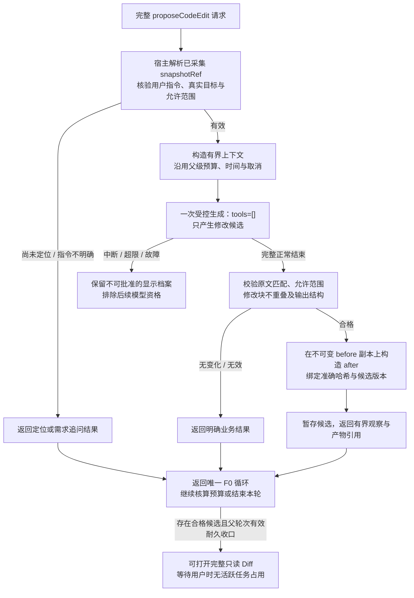

# F2 内部 A2：双入口共用的候选生成

日期：2026-10-25（Asia/Shanghai）。返回[主图](f2-code-edit-main-2026-10-25.md)，目标与快照来自[内部 A1](f2-code-edit-internal-target-2026-10-25.md)或合法的已捕获选区。

本稿修订[10月24日生成图](f2-code-edit-internal-generation-2026-10-24.md)中“提交时已固定Document快照”的前提：有选区时可固定已有同版快照；无选区时先解析目标，采集成功后固定snapshotRef。原提交仍不可变，派生目标/源码作为有来源的工具观察与产物保存，不能虚构为用户提交的代码。

模型只能请求宿主已分配且归属/修订有效的snapshotRef；缺目标先定位，缺需求先追问，不要求用户为了通过校验而手动选一段无关代码。原JUnit场景长度规则不迁移到F2。

固定整文件before供宿主构造准确Diff，但模型只读取必要范围及有界上下文。生成工具只输出候选，不接任意路径写入，不自动扩展目标、运行测试或格式化。单文件/整份批准依旧是实施提案，用户本轮未新增多文件需求。

一个生成调用内部至多一次tools=[]模型请求，归父级统一预算/取消/次数；只有实际tool_call才产生配对观察。无合格候选、父操作中断/失败或未耐久收口时均不得批准。显示档案与未来模型资格遵守既有F0规则。

后续沿用[批准与应用图](f2-code-edit-internal-apply-2026-10-24.md)：明确Diff用户决定→新宿主单槽操作→复验Document及准确候选→应用获批after；源码变化使旧批准失效，不自动覆盖用户后改内容。应用只消费获批的固定targetRef和before/after，不能重新解析后把旧批准转给另一个文件或方法。已应用、磁盘已保存、回执待恢复分别报告。

图源：[f2-code-edit-internal-generation-2026-10-25.mmd](f2-code-edit-internal-generation-2026-10-25.mmd)。本轮未实现或实测这些F2能力。
