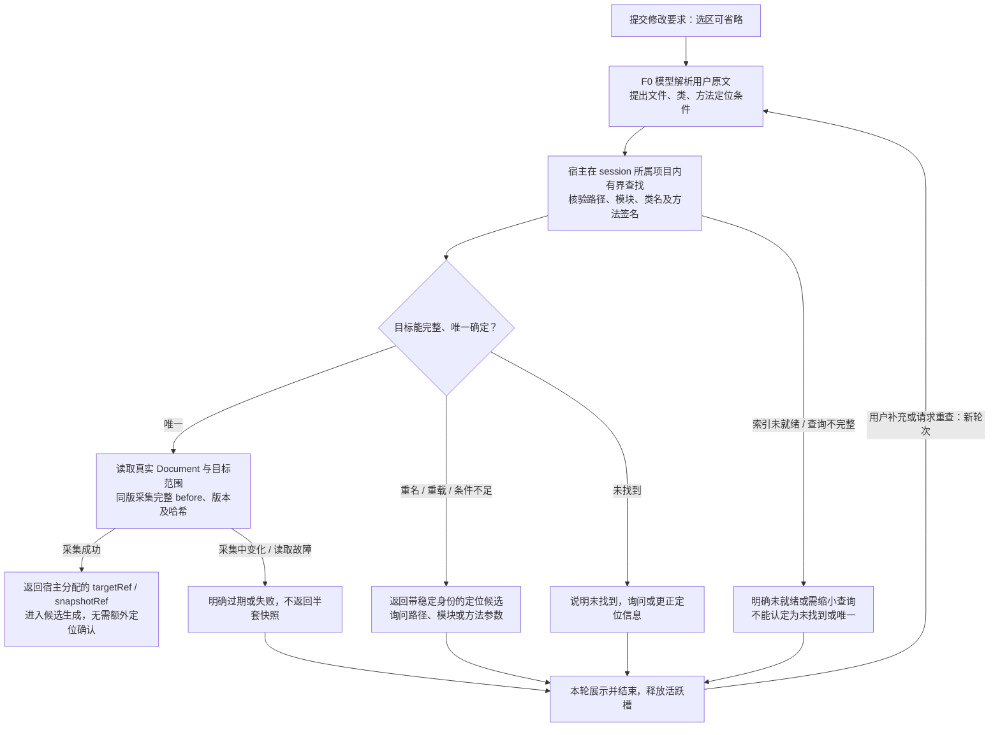

# F2 内部 A1：文字定位目标与源码快照

日期：2026-10-25（Asia/Shanghai）。用户要求依据[user-turn-074](user-turn-074.md)，返回[主图](f2-code-edit-main-2026-10-25.md)。支持不选中代码来自用户；以下解析与交互细节为代理提案。

- 项目来自原提交固定的session归属，不能在异步完成时改用当前编辑器或其他项目。文字可提供相对路径、模块、类全名、方法名及参数类型；这些是帮助消除歧义的可选线索，不要求用户填齐固定表单。
- 使用所有已给线索联合筛选。同名文件/同名类不一定需要追问：若路径、类、方法签名等联合条件已经唯一，直接继续。重载仍多义时列出如findUser(String)、findUser(long)及路径/模块，让用户选择或补充，不能用首个搜索结果或模型置信度代替唯一性。
- 定位查询只返回有界候选元信息；结果被限额截断、索引未就绪或解析失败时明确对应状态。仅展示一个候选不能据此推定全范围只有一个。正常未找到与平台读取/索引故障分开，不静默扩大到其他项目、依赖源码或当前光标附近。
- 用户补充选择后按新轮次复验候选身份与修订，不能把旧序号映射到后来重排的新文件。等待用户结束本轮并释放槽，不持读锁/数据库事务等待。
- 唯一目标无需额外定位确认。宿主有界读取真实Document（包含未保存文本），核验文件身份、类/方法、范围及版本一致后保存完整before与snapshotRef；采集中源码变化则明确过期，不返回拼凑或半套结果。范围由明确用户目标和提案策略确定，不能暗中扩成整文件重写。
- 这是新增只读查找/采集能力的设计，不假称现有CodeCapturePort(SelectionStart)已接受空选区。普通F0代码问答仍沿用现有捕获；F2需增量契约或适配边界，但本轮不实现。
- 定位结果与快照只是生成依据，不是批准。之后仍需生成完整候选、父操作有效耐久收口、Diff展示和实际用户批准，应用前再次检查Document基线；不采用模型记忆中的源码。

图源：[f2-code-edit-internal-target-2026-10-25.mmd](f2-code-edit-internal-target-2026-10-25.mmd)。
