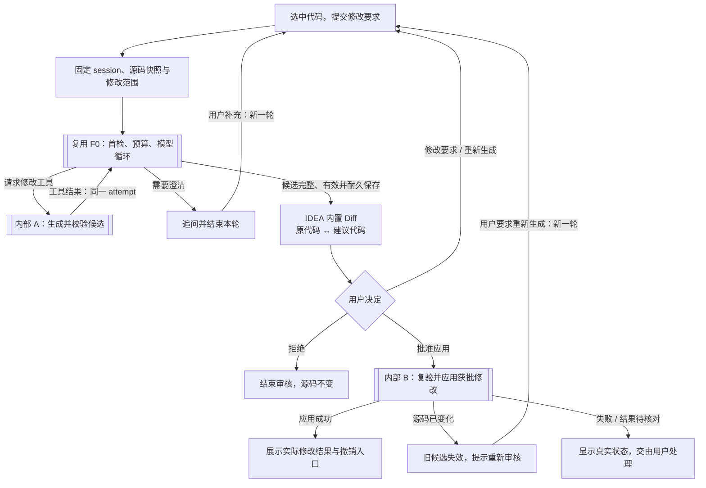

# F2 源码修改：主流程方案（讨论稿）

日期：2026-10-24（Asia/Shanghai）。本轮请求：[user-turn-051](user-turn-051.md)；原需求：[作业提取正文](assignment-extracted.txt)第84–93行（原作业第2页）。沿用[user-turn-039](user-turn-039.md)“先设计可接MCP的工具边界，协议按需引入”及[user-turn-049](user-turn-049.md)主图精简、内部处理另绘的偏好。

## 需求与提案

- 原作业要求：按用户指令进行显著源码修改，如方法重构、应用设计模式或修复bug；应用前必须使用IDEA内置Diff提供并排比较，让用户审核并批准。
- 本轮用户只要求讨论及流程图，不授权实施F2、改F0产品基线或冻结架构。F0第五组已按本地CURRENT最新记录合入main，当前dev-manager为5ec16c4；人工/真实API验收仍未完成。当前已有真实editor/pdf/ui接线，不能沿用旧“UI占位”状态。
- 代理首版提案：从已明确的单文件及代码范围开始，整份候选批准；采用当前IDEA Document（包括尚未保存的用户编辑）作为基线。批准后应用到编辑器并支持Undo，不额外强制保存；磁盘是否已保存另如实显示。这些范围细节尚未获用户逐项确认。
- 入口右键动作、卡片schema、具体工具名及批准控件是提案。示意边界proposeCodeEdit(requestRef)只生成候选，applyApprovedCodeEdit(applyId)只消费宿主保管的获批产物；先做纯Java本地边界，MCP协议以后按需适配，不增加服务进程。

## 主流程

普通文字说明、无需修改、错误与取消由F0既有终态处理；主图只画候选审核主线。首次课程检索仍按新attempt一次，工具结果回同一循环，不重复首检。课程能力与源码修改能力须分别判定，不能把“无课程库”当作禁用修改工具。

Diff需要完整before/after，而当前F0捕获只有原选区、完整所在方法和类结构；不能把类结构摘录误当整文件。F2需新增有界目标快照/编辑候选契约，宿主从固定全文副本构造对比结果，模型只获得必要的已授权上下文。

生成候选是工具观察，仍需外层正常终态、资格校验与耐久收口才能批准。只有工具调用存在时才保存配对tool消息，候选不伪装课程证据。审核等待释放活跃槽；重新生成/补充指令是新轮次，旧批准不可复用。关闭Diff仅关闭视图，不代表批准、拒绝或应用。

按钮批准由宿主直接开始新应用操作，不重调模型、不重做课程检索。首版图按Diff明确按钮决定；文字批准若以后支持，须绑定明确版本、核实用户原文并结束解析操作释放槽，再汇入同一应用入口，不能靠模型approved=true取得资格。

## 内部图与未决项

- [内部A：候选生成与校验](f2-code-edit-internal-generation-2026-10-24.md)
- [内部B：批准、应用与结果恢复](f2-code-edit-internal-apply-2026-10-24.md)

多文件一致性、跨文件读取、逐块批准、可编辑候选、自动格式化/优化imports、自动保存以及编译/测试均留待后续范围讨论。修改候选的基础结构/语法检查不等于语义正确或测试通过；本轮不增加运行任意代码能力。

## 平台依据与当前缺口

当前ReactEngine仍以CourseTools.DEFINITIONS构建请求，allowTools取决于课程库状态；ReactData.Input只有question与CodePart列表。SessionCoordinator和实际JavaCodeCapturePort可复用身份/固定版本/单槽语义，但没有F2候选、Diff批准和应用操作。需增量契约与能力策略，不能仅改提示词即宣称接入完成。

官方[Diff Viewer说明](https://www.jetbrains.com/help/idea/differences-viewer.html)指出可编辑本地内容及直接应用差异。因此本方案建议让IDEA内置Diff比较两份不可变只读快照，用明确批准事件进入宿主工具，避免预览动作先改真实文件。这是方案推导，目标IDE具体装配仍待验证。

官方[Documents说明](https://plugins.jetbrains.com/docs/intellij/documents.html)及[Working with Text](https://plugins.jetbrains.com/docs/intellij/working-with-text.html)支持以Document处理编辑器文本、在写命令中修改并进入Undo体系。具体API、只读配置、Undo可用性/粒度和本机版本接入还需实际IDE场景，引用官方说明不等于本插件验证通过。上述网页于2026-10-24读取，仅记录用途摘要，不转存全文。

图源：[f2-code-edit-main-2026-10-24.mmd](f2-code-edit-main-2026-10-24.mmd)。本轮仅新增忽略的讨论证据，原F0图、产品代码与WORKING不变；未执行F2实现、IDE/API或外部图像渲染验证。
