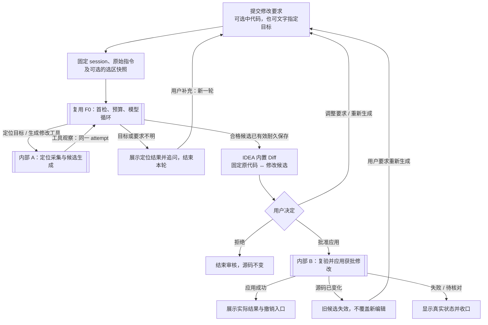

# F2 双入口主流程：可选选区与文字定位

日期：2026-10-25（Asia/Shanghai）。用户新增要求：[user-turn-074](user-turn-074.md)。本稿增量修订[上一版主图](f2-code-edit-main-2026-10-24.md)，保留历史原文和图源。

## 用户要求与提案边界

已明确新增的用户要求是：不要求先选中代码，允许在文本中指出待修改文件、类、方法及预期行为，例如用户原文中的“修改***.java中xxx类的xxx方法，我希望实现xxx”。文件名、类名和方法名是定位线索；具体字段、只读解析工具及歧义交互是本轮代理提案。

输入包含可选选区；纯文本不因“没有捕获组”被拒绝。宿主在提交时固定session/项目归属、原始指令、历史边界及已有选区，未解析目标保持显式待定位状态，不伪造源码快照。该要求只扩展讨论中的F2入口，不表示F2已经实施。

[内部 A1：只读定位与快照采集](f2-code-edit-internal-target-2026-10-25.md)；[内部 A2：候选生成](f2-code-edit-internal-generation-2026-10-25.md)；[内部 B：批准与应用](f2-code-edit-internal-apply-2026-10-24.md)。

## 对 F0 编排的增量

模型在现有F0步骤内分析用户定位意图，宿主的resolveEditTarget(requestRef)示意工具只在本session所属项目允许源码内查找并读取。定位和生成是同一外层循环中的不同受控调用；观察回预算节点，同一attempt不重做首检、不新增第二循环或独立模型解析session。选区已能明确目标且与文字一致时可直接使用合法F2完整前像快照；只有现有F0选区/方法/类结构片段时，仍须补采同版完整before，不能将片段当整文件；文字指向其他目标或与选区冲突时，按显式文字解析或澄清，不静默误绑。

宿主对真实项目文件及方法进行解析，模型不能自行编造路径、源码或snapshotRef。唯一目标直接采集并进入生成，不增加一次“是否这个方法”的强制确认；有歧义、未找到或查询不完整时才补信息。定位确定只授权按原要求生成候选，最终源码修改仍必须经过IDEA内置Diff与用户批准。

无选区时，快照在实际目标解析并采集成功时固定，而非假称提交时已知源码。保留提交原文与派生观察的来源关系，不改写原用户消息；后续定位/生成消费同一个宿主snapshotRef。采集时保存完整Document before供Diff和基线校验，送给模型的源码仍按目标与上下文预算限定。未保存的编辑也属于Document基线。

单文件、整份候选批准、本地Java工具边界及后续可接MCP等继续是提案。项目内只读定位不等于允许任意文件读取、整项目上传或跨文件修改；命中多个文件不变成多文件批量改动授权。候选/真实应用的资格、版本漂移、Undo及本地终态收口仍沿用前稿，不因无选区而绕过批准。

## 本轮范围与证据

本轮仅更新忽略的F2讨论证据。现有工作区已暂存的editor/ui产品改动保持原样，不暂存、不撤销、不提交；F0当前进度以CURRENT及本分支交接为准，不把10月24日历史状态当最新结论。WORKING与正式基线不变。

图源：[f2-code-edit-main-2026-10-25.mmd](f2-code-edit-main-2026-10-25.mmd)。未执行F2实现、IDE/API或外部图像渲染验证。
