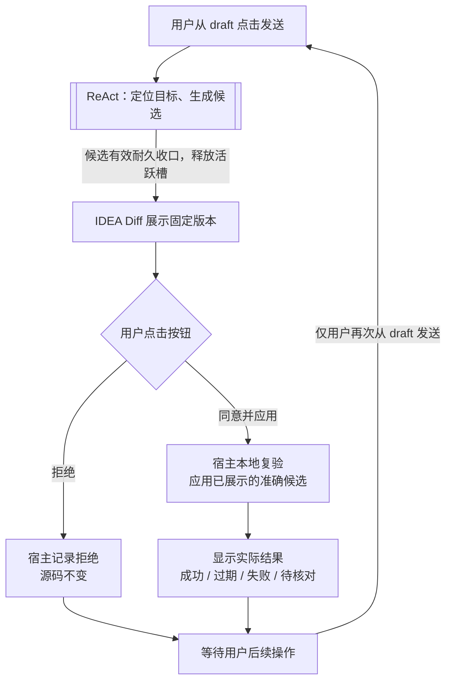

# F2 已确认：关键约束及两个本地审核按钮

日期：2026-10-25（Asia/Shanghai）。确认依据：[user-turn-075](user-turn-075.md)；之前文字定位入口见[user-turn-074](user-turn-074.md)及[双入口主图](f2-code-edit-main-2026-10-25.md)。

## 本轮确认的范围

用户明确同意此前命名的三个关键约束，并扩展第三点。所承接的助手原文单独保存在user-turn-075“被确认的既有提案”区，不能将该区误认作用户逐字正文。

1. 预览不修改项目：Diff比较固定的原代码和候选副本。
2. 批准绑定准确版本：源码或候选发生变化，必须重新展示Diff、重新批准。
3. 应用不再调用模型：直接使用已展示候选，通过IDE写命令支持Undo；“已应用到编辑器”和“已保存到磁盘”分别报告。

第三点新增已确认要求：审核提供准确标签“同意并应用”“拒绝”；两个按钮入口均不进入ReAct。只有用户再次在draft发送，才重新进入ReAct。

## 审核与再次提交

生成候选的ReAct操作必须已正常、有效、耐久收口，释放活跃槽后才等待审核；审核不是挂住旧循环的等待步骤。

“同意并应用”是宿主本地应用命令，绑定已展示的候选及before/after/目标范围；复验项目、会话、运行资格与当前Document基线后应用，按已有提案记录回执与恢复状态。它不调用模型、不做首次课程检索、不进入下一模型步骤，也不自动请求模型生成结果说明；UI直接展示真实本地结果。

“拒绝”是宿主本地审核事件，记录对应候选被拒绝，源码不变；它不进入ReAct、不自动改写候选、不替用户提交补充问题。候选身份/修订、去重与并发仲裁的具体字段仍是实现提案。

应用过期、拒绝、失败或结果待核对都停在真实本地状态；不能由这些结果自动重定位、重新生成、追问、重试或续接旧ReAct。局部存储恢复只核验/补记，不隐式调用模型或重放编辑。占槽操作仍按既有规则终态收口，保存失败/待核对可见阻塞，不能悬挂运行任务等用户。

下一次ReAct只能来自用户显式的draft发送。用户可以在draft修改要求、补充目标或提出新问题；两个审核按钮不触发SubmitDraft、不合成用户消息，也不消费或覆盖用户现有draft。UI展示审核/应用事实不伪造无配对的模型tool消息。

用户从draft发送的文字按新用户提交处理。本轮只确认上述两个按钮入口，不据此额外确认以自然语言替代按钮批准的具体协议；先前“文本批准以后支持”的提案不自动升格为已确认。

## 对旧图的修订及未确认项

[10月25日主图](f2-code-edit-main-2026-10-25.md)中审核后“调整要求/重新生成”和失效后“用户要求重新生成”的回边，现统一明确为用户再次从draft发送。没有审核按钮直返ReAct、自动重生成按钮或失败后的自动模型续写。原始图文保留为历史，本记录是审核交互边界的后续确认。

选区可省略、文本指向目标仍适用；唯一目标定位后无需额外定位确认，但修改仍需以上Diff审核。具体单文件/多文件范围、整份/逐块批准、MCP适配、存储字段、幂等和恢复算法、是否强制保存等未由本轮全部确认。

本轮只记录确认与图示，不实施F2，不修改F0公开基线、WORKING或当前已暂存产品文件，不处置分支或PR。讨论中确认的业务约束不等于正式架构冻结或功能验收。

图源：[f2-review-buttons-2026-10-25.mmd](f2-review-buttons-2026-10-25.mmd)。
