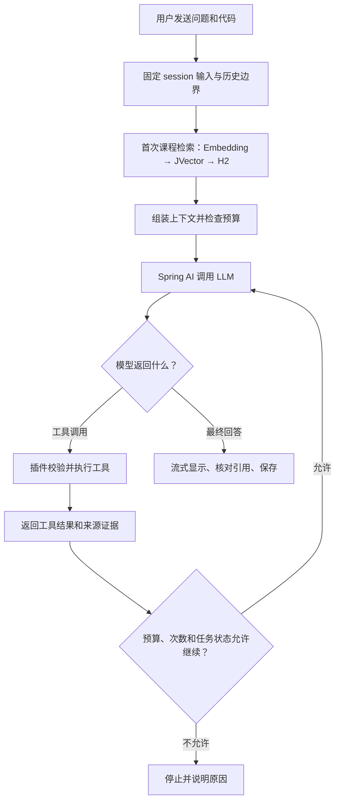

# 用户采纳 ReAct 流程

来源：当前 Codex 会话用户原文，2026-10-18（Asia/Shanghai）。

## 原文

实现按这个流程图来。我认为F1/F2可归入工具调用，你的看法？

## 被指代的上一回复流程图

以下是代理上一回复的图文上下文；用户本条明确采纳流程图。后半句询问扩展归属，不据此确认为本轮交付功能；随后范围澄清见 user-turn-031.md。

采纳范围为首轮课程检索加模型工具循环的主流程；具体工具名、循环次数、库版本及协议状态算法仍需实施设计和验证。
